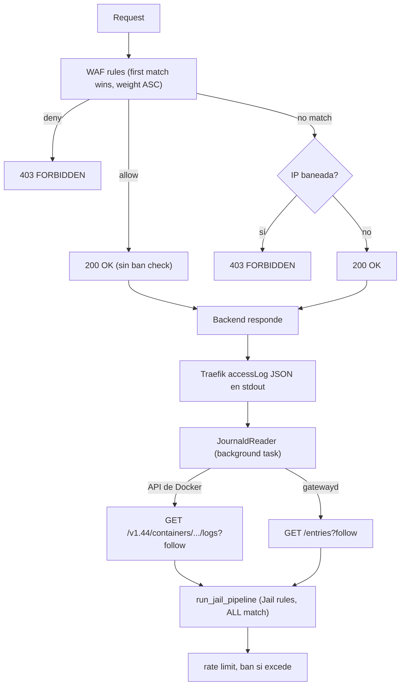

# AGENT DIRECTIVES: OPENSPEC (SDD) + TDD WORKFLOW

## ⚠️ REGLA DE ORO — LEER ANTES DE ACTUAR

**ANTES de escribir o editar CUALQUIER archivo de código fuente (Rust, TypeScript, JSX, CSS, etc.),
debes ejecutar `just check-spec` para confirmar que existe un change proposal aprobado.**

Si `just check-spec` falla:
1. DETENTE inmediatamente.
2. Informa al usuario que no hay un change proposal activo.
3. Pregunta si quiere crear uno con `openspec new change <feature>`.
4. NO escribas código hasta recibir aprobación explícita.

**SALTARSE ESTE PASO ES VIOLACIÓN DEL PROTOCOLO.**

---

## I. CORE PRINCIPLES & GOALS

- **Phase 0 — Legacy Support:** If modifying existing code without specs or tests, establish a baseline spec and characterization tests before introducing changes.
- **Phase 1 — SDD (OpenSpec):** No new code or tests may be written before a spec change proposal exists in `openspec/changes/<feature>/` and is approved by the user.
- **Phase 2 — TDD (Red-Green-Refactor):** Once the spec is approved, code MUST be developed strictly test-first using terminal commands.
- **Strict Verification:** Always run CLI test suites using terminal tools. Never assume code or tests pass/fail without CLI confirmation.

---

## II. EXECUTION WORKFLOW

### Phase 0: Legacy Code Preparation (Conditional)

*Execute this phase ONLY if modifying an existing module/file that lacks OpenSpec documentation or tests.*

1. **Characterization Spec (As-Is):**
   - Inspect the target file/module.
   - Generate a baseline spec in `openspec/specs/<module>/spec.md` reflecting current behavior.
2. **Characterization Tests:**
   - Write Rust (`#[test]`) or React/TS (`vitest` / `@testing-library/react`) tests matching current behavior.
   - Run tests via CLI (`cargo test` or `npx vitest run`) to confirm all pass in **GREEN**.

### Phase 1: SDD Protocol (OpenSpec)

When the user requests a new feature, bug fix, or refactor:

1. **Create the Change Proposal:**
   - Execute CLI command: `openspec new change <feature-name>`
2. **Draft Specifications:**
   - Populate `openspec/changes/<feature-name>/proposal.md` with intent, scope, and impact.
   - Create spec deltas in `openspec/changes/<feature-name>/specs/<module>/spec.md`.
   - Ensure the spec includes:
     - **Contracts:** Rust types/structs/enums, TypeScript interfaces/props, API endpoints, or function signatures.
     - **Scenarios (BDD style):** Detailed `Given / When / Then` clauses for happy path, error cases, and edge cases.
   - Populate `openspec/changes/<feature-name>/tasks.md` with the TDD task checklist.
3. **STOP & WAIT FOR APPROVAL:**
   - Present the created specification to the user.
   - **DO NOT** write application code or new tests until the user explicitly approves the spec.

### Phase 2: TDD Protocol (Red-Green-Refactor)

Once the user approves the spec (e.g., "Approved", "Looks good", "Proceed with TDD"):

1. **RED (Write Failing Tests):**
   - Read the `Given / When / Then` scenarios in `openspec/changes/<feature-name>/specs/`.
   - Write tests in Rust or React/TypeScript corresponding to those scenarios.
   - Execute CLI tests (`cargo test` or `npx vitest run`).
   - **Verify:** Confirm test failure for the new functionality while any legacy tests remain **GREEN**.
2. **GREEN (Minimal Implementation):**
   - Write the absolute minimum code necessary to satisfy the failing tests.
   - Execute CLI tests (`cargo test` or `npx vitest run`).
   - Run type checks (`cargo check` or `npx tsc --noEmit`).
   - **Verify:** Confirm all tests pass (100% green) and no compilation/type errors exist.
3. **REFACTOR (Clean & Consolidate):**
   - Clean up code formatting, types, and structure without altering behavior.
   - Run linters (`cargo clippy -- -D warnings` / `npm run lint`).
   - Re-run test suites via CLI to guarantee no regressions.
4. **CONSOLIDATE & ARCHIVE:**
   - Mark completed items in `tasks.md`.
   - Once all scenarios pass, run `openspec archive <feature-name>` to merge the delta into `openspec/specs/`.

### Practical Lessons Learned (SDD + TDD)

#### Archive requires exact header matching
`openspec archive` busca el header exacto del delta en la spec destino. Si el header del delta es `"### Requirement: Pipeline evaluation order (WAF first)"` pero la spec tiene `"### Requirement: Pipeline evaluation order"`, el archive falla. **Los headers del delta deben copiar EXACTAMENTE los de la spec destino.**

#### Si reescribes la spec directamente, no intentes archivar
Si modificaste `openspec/specs/<module>/spec.md` a mano (fuera del mecanismo de archive), el change proposal correspondiente queda huérfano. No se puede archivar porque los headers ya no coinciden. **Solución: eliminar el directorio del change proposal** (`rm -rf openspec/changes/<feature>/`).

#### Cambios en cascada
Eliminar una entidad (ej. Whitelist/Blacklist) puede dejar código muerto en otras partes (ej. `AppError::Conflict`, tests de Conflict). El REFACTOR phase debe incluir la limpieza de estos artefactos. **Siempre ejecutar `cargo clippy -- -D warnings` tras el GREEN phase para detectar código/ variantes no usados.**

#### `openspec archive --yes` no bypassa validación de headers
La flag `--yes` salta la comprobación de tareas incompletas, pero NO la validación de que los headers del delta existan en la spec destino. Si los headers no matchean, el archive igual falla.

#### Mantén openspec artifacts sincronizados con el código
Si implementas un cambio en código pero no actualizas los artifacts de openspec (tasks, proposal), el change proposal queda "stuck" — no se puede archivar ni continuar. **Antes de empezar un nuevo cambio, verifica que no haya cambios activos huerfanos con `openspec list`.**

---

## III. PROJECT CONFIGURATION & CONVENTIONS

### Stack Commands

#### Backend: Rust
- **Test Runner:** `cargo test` (or `cargo nextest run` if available).
- **Type Checking & Linting:** `cargo check` and `cargo clippy -- -D warnings` (enforce zero warnings).
- **Formatting:** `cargo fmt --check`
- **Conventions:**
  - Structs and types placed in domain modules or `src/models/`.
  - Unit tests placed in the same file under `#[cfg(test)]`.
  - Integration and API tests placed in `tests/`.

#### Frontend: React + TypeScript
- **Test Runner:** `npx vitest run` or `npm test -- --watch=false` (single-pass execution).
- **Type Checking:** `npx tsc --noEmit` (mandatory during GREEN/REFACTOR steps).
- **Linting & Formatting:** `npm run lint` / `npx eslint .`
- **Conventions:**
  - Components in `src/components/`, hooks in `src/hooks/`.
  - Component tests colocated as `Component.test.tsx` using `@testing-library/react`.
  - User-centric testing behavior using `@testing-library/user-event` instead of implementation details.

### Custom Repository Rules

- Insert here any specific business logic, database conventions, or custom architectural rules unique to this project.

---

## IV. RESPONSE FORMAT & STATUS MESSAGES

Always prefix your progress updates with the current status tag:

```text
[LEGACY - INSPECT] Creating baseline spec & characterization tests.
[OPENSPEC - DRAFT] Generating change proposal in openspec/changes/...
[OPENSPEC - WAITING] Spec generated. Awaiting user review and approval.
[TDD - RED] Creating tests for scenario <Name> -> Running CLI tests.
[TDD - GREEN] Implementing minimal code -> Running CLI tests & type checks.
[TDD - REFACTOR] Refactoring code -> Running Clippy/ESLint & tests.
[OPENSPEC - ARCHIVE] Archiving change into openspec/specs/.
```


## V. CURRENT PROJECT STATE

### Pipelines

Shuul opera **dos pipelines** sobre un mismo conjunto de reglas:

| Pipeline | Endpoint/Fuente | Rol | Comportamiento |
|---|---|---|---|
| **WAF** | `ANY /api/v1/shuul` | ForwardAuth — interceptar, matchear, allow/deny | Primera regla que matchea gana (break por weight ASC) |
| **Jail** | `JournaldReader` (background; API de Docker o gatewayd) + `POST /api/v1/report` (HTTP) | Rate limiter post-factum (fail2ban-style) | TODAS las reglas que matchean cuentan |

#### Flujo completo



Ambos caminos (el reader de journald y el endpoint HTTP) llaman a la **misma** función
`run_jail_pipeline(app_state, payload)` en `http/report.rs`.

#### JournaldReader — transporte

`backend/src/journald_reader.rs` habla HTTP/1.1 con `hyper`
(`client::conn::http1`), que es genérico sobre `AsyncRead + AsyncWrite`. El mismo
cliente sirve para **cuatro** transportes repartidos en **dos backends**:

- la **API de Docker**, por socket Unix `AF_UNIX` o por TCP contra un proxy;
- **`systemd-journal-gatewayd`**, por socket Unix `AF_UNIX` o por TCP.

El backend y el transporte se eligen por variable de entorno; no hay dos
implementaciones de la petición ni del parseo.

| Backend | Transporte | Cuándo | Variable |
|---|---|---|---|
| **API de Docker** | Socket Unix (`AF_UNIX`) | Sin proxy. Solo si aceptas montar el socket de Docker (equivale a root en el host). Motor y Shuul en el mismo host | `SHUUL_DOCKER_SOCKET` |
| **API de Docker** | TCP (proxy) | **Recomendado.** Un `docker-socket-proxy` delante del socket, en red interna. No exige permisos del host | `SHUUL_DOCKER_URL` |
| **gatewayd** | Socket Unix (`AF_UNIX`) | Backend de menor prioridad: sólo si mantienes gatewayd. Sin puerto, sin regla de firewall | `SHUUL_JOURNALD_SOCKET` |
| **gatewayd** | TCP | Sólo para un gatewayd en otra máquina o cuando no se puede montar el socket | `SHUUL_JOURNALD_URL` |

Las dos URL base TCP (`SHUUL_DOCKER_URL` y `SHUUL_JOURNALD_URL`) aceptan
`tcp://` como **sinónimo** de `http://`: es un alias del mismo transporte —misma
autoridad y misma petición, no una variante— y `endpoint_display()` normaliza
siempre al esquema efectivo (`http`).

**Precedencia completa** (primer valor definido y no vacío gana; un valor en
blanco equivale a no definido):

`SHUUL_DOCKER_SOCKET` → `SHUUL_DOCKER_URL` → `SHUUL_JOURNALD_SOCKET` →
`SHUUL_JOURNALD_URL` → `http://localhost:19531`.

Dentro de cada backend el socket gana a su URL y se emite un `warn!` nombrando la
URL ignorada. El backend de más prioridad gana sin llegar a evaluar las variables
de los otros como transporte.

- **Contenedor (D1):** `SHUUL_DOCKER_CONTAINER` → si falta o está en blanco,
  `SHUUL_JOURNALD_CONTAINER` → si también falta, `traefik`. El fallback hace que quien
  ya apuntaba al contenedor correcto con la variable de journald siga apuntando al
  mismo contenedor al cambiar de backend.
- **Petición — gatewayd:** `GET /entries?follow&CONTAINER_NAME={container}` en **forma
  origen** (`path?query`) más cabecera `Host`, `Accept: application/json` y un `Range` de
  reanudación (`entries=<cursor>:…`) tras una reconexión. El filtrado por contenedor lo
  delega el servidor (`KEY=match`). El `Range` es sólo una **pista**: la corrección no
  depende de él.
- **Petición — API de Docker:**
  `GET /v1.44/containers/{container}/logs?follow=1&stdout=1&stderr=1&tail=0&timestamps=1&since={epoch}`
  más `Host` y `Accept: application/json`. **Nunca** se envían `Upgrade` ni
  `Connection: Upgrade`: con esas cabeceras el motor contesta `101 UPGRADED` en lugar de
  servir el stream (sin ellas, `200 OK` con `application/vnd.docker.raw-stream`). La
  versión `v1.44` frente a un motor 1.50 es deliberada: el motor negocia hacia abajo, así
  que la misma imagen vale para motores más antiguos. El filtrado por contenedor lo delega
  el servidor por el segmento `{container}` del path; con socket la cabecera `Host` vale
  `docker`, con TCP es la autoridad del endpoint. El path y la query son idénticos en los
  dos transportes.
- **Parser y asunción de TTY:** el motor multiplexa el stream en **frames** de 8 bytes
  (byte de stream, 3 de relleno, longitud big-endian de 4) **sólo** en contenedores sin
  TTY. El parser es **incremental** —mantiene el estado entre chunks—: un frame partido
  entre dos chunks se decodifica al completarse y un chunk con varios frames los decodifica
  todos. `stdout` va al pipeline; `stderr` se descarta a nivel `debug`. Un identificador de
  stream fuera de `{0,1,2}` —un JSON crudo empieza por `{`— **descarta la conexión** con un
  warning que **nombra** la causa probable (un contenedor con TTY), de modo que el síntoma
  deja de ser una avería muda. **`tty: true` está prohibido** en el contenedor de Traefik.
- **`timestamps=1`** hace que cada carga llegue como `<instante RFC3339Nano> <línea JSON>`:
  el lector extrae el instante, descarta el prefijo y entrega el resto a
  `parse_traefik_access_log` sin cambiar el parseo de la línea. El camino de Docker va
  **directo** a esa función: **no** pasa por `extract_report_payload` ni por
  `is_traefik_entry`, que **exigen el campo `CONTAINER_NAME`** —que las cargas del stream no
  traen— y descartarían el **100 %** de las líneas en silencio.
- **Campos del `ReportPayload` y lo que el transporte no puede aportar:** el lector mapea 14
  campos; **cinco** dependen de que Traefik emita las claves de cabecera del access log
  (`request_User-Agent` → `user_agent`, `request_Referer` → `referer`,
  `request_Content-Type` → `content_type`, `request_Accept-Language` → `accept_language`,
  `request_X-Request-Id` → `x_request_id`). Traefik **no** las emite por defecto
  (`accessLog.fields.headers.defaultMode: drop`), así que en una configuración por defecto
  llegan **siempre** vacías. **Ningún backend las inventa**: la API de Docker y gatewayd
  transportan el mismo JSON, así que la disponibilidad depende del **origen**
  (`accessLog.fields.headers.names` del `traefik.yml`, que vive **fuera** de este
  repositorio), no del transporte. Cuando la clave falta, el mapeo resuelve el campo a
  `None` **sin descartar la línea** (un access log sin `request_*` sigue siendo válido).
  Desde `missing-header-fields`, una regla que **restrinja** uno de esos campos y reciba
  `None` **no casa** —antes casaba por ausencia— y el matcher lo registra con un `debug!`
  que nombra el campo y la regla (`RUST_LOG=backend=debug`). El mismo contrato vale para
  `country_code` cuando el GeoIP no resuelve la IP. Ver `SELF-HOSTING.md` §2.15.
- **Corte por intento de conexión:** cada intento fija su corte en el instante en que
  empieza (µs) y sólo se entrega al pipeline lo **estrictamente posterior**. `since` es el
  **filtro grueso del servidor** —granularidad de segundo— y una mera **pista**, con el
  mismo papel que el `Range` de gatewayd; la corrección la da la comparación **exacta** con
  el instante que precede a cada carga. Lo escrito mientras shuul estaba caído —o entre dos
  intentos— **no** cuenta para el rate limiting: `RateLimiter::record()` sella con
  `Instant::now()`, así que reproducir el histórico al arrancar banearía IPs con historial
  de escaneo. Es un fail-open **deliberado**, idéntico al de journald; el WAF sigue
  protegiendo porque es síncrono y no depende de este transporte.
- **Limitación de reloj (heredada de journald, `journald_reader.rs:40-43`):** la
  comparación asume que el emisor y Shuul comparten reloj. Con el daemon en la **misma
  máquina** —los modos A y B, mismo-host por definición— se cumple; un daemon de Docker en
  **otra** máquina queda **fuera del contrato** (emisor atrasado → tráfico legítimo
  descartado en silencio; emisor adelantado → replay del backlog proporcional al desfase).
- **Descarte y dedupe:** gatewayd descarta por `__REALTIME_TIMESTAMP` y, tras reconectar,
  por `__CURSOR` (evita reprocesar la entrada de la reanudación); Docker descarta por el
  instante de la carga. Un descarte es silencioso a nivel `INFO` (a lo sumo `DEBUG`) y no
  cuenta como error. En Docker el descarte **no** se basa en el contenido de la línea: dos
  peticiones reales pueden compartir IP, path, status y segundo.
- **`endpoint_display()`** produce el endpoint de la línea de arranque, con un formato por
  backend: `unix:/run/systemd/journal/gatewayd.sock` o `unix:/var/run/docker.sock` para los
  sockets, y `scheme://host:port` para TCP. El backend de Docker añade el contenedor entre
  paréntesis: `docker:unix:/var/run/docker.sock (traefik)` o
  `docker:http://docker-socket-proxy:2375 (traefik)`. En TCP el **path base** de la URL se
  ignora (se avisa con un `warn!`): el endpoint efectivo es siempre `scheme://host:port`.
- **Fail-open:** si el backend no está disponible se emite un `warn!` que **nombra el
  backend y el endpoint** —`journald gateway not available` o `docker api not available`—
  y se reintenta cada 30 s. El WAF nunca se ve afectado.
- **Compatibilidad:** `SHUUL_JOURNALD_*` sigue funcionando con la misma semántica, así que
  el rollback es cambiar variables de entorno, no volver a una imagen anterior. journald se
  **mantiene** como backend de menor prioridad; **no** se retira.
- El contenedor ve el socket de gatewayd porque `compose.yml` monta el **directorio**
  `/run/systemd/journal:/run/systemd/journal:ro` (un bind de fichero se queda atado a un
  inodo muerto cuando systemd recrea el socket). En el modo A de Docker se monta
  `/var/run/docker.sock` y se añade el grupo del socket; ver la sección de Docker más abajo.

#### WAF (`shuul.rs`)

- **No evalúa rate limits.** Solo matching + allow/deny.
- **Pipeline:** WAF rules (first match wins) → Ban check (si no hay match).
- Primera regla que matchea (por weight ASC) gana. `break` tras encontrar una.
- `mode = "off"` → skip. `mode = "log_only"` → allow=true. `mode = "enforce"` → apply allow/deny.
- Si una WAF rule matchea con `allow=true` → 200 OK inmediato (no se evalúa ban).
- Si ninguna WAF rule matchea → se comprueba si la IP está baneada → 403 si sí, 200 si no.
- No hay concepto de `store` — ya no persiste requests individuales.
- **No existen** entidades Whitelist ni Blacklist separadas. Su función se cubre con WAF rules de peso bajo.

#### Jail (`report.rs`)

- **Único pipeline que evalúa rate limits.**
- Itera TODAS las reglas (sin break). Cada regla con `rate_limit_profile_id` es un "jail" independiente.
- Para cada match: carga perfil desde DB, si `status_code ∈ fail_codes` → `record()` + ban si excede.
- Fire-and-forget: siempre devuelve 200 OK.
- Recibe `ReportPayload` desde el plugin de Traefik (legacy) o desde el `JournaldReader` (API de Docker o gatewayd); ambos caminos convergen en `run_jail_pipeline`.
- **El peso de una regla de Jail es siempre 0.** El pipeline de Jail itera **todas** las reglas que casan, sin `break`: su orden no decide nada, así que un peso distinto de 0 sería una elección sin efecto que la interfaz, además, oculta. El catálogo declara 0 para las **18** plantillas de Jail (`templates.rs`); la API impone 0 al **crear, editar e importar** una regla con `pipeline: "jail"` (helper único `models::normalized_weight`); y la migración `20261023000000_normalize_jail_rule_weight.up.sql` normaliza a 0 lo ya almacenado. **El WAF no se ve afectado** porque salta las reglas jail-only (`shuul.rs`), y allí el peso sí decide (`first match wins` por `weight ASC`).
- **La lista de reglas desempata por `rules.id`.** `read_paged` ordena por el criterio pedido y desempata por `rules.id ASC`, para que dos consultas con pesos repetidos devuelvan **el mismo** orden y la paginación con `LIMIT ? OFFSET ?` no repita ni pierda filas empatadas. **No** se aplica al `ORDER BY weight ASC` que carga las reglas del WAF: el orden de evaluación se queda como estaba.

### CacheRule

`CacheRule` en `backend/src/models/rule.rs` envuelve una `Rule` con un **conjunto ordenado de condiciones** (`Vec<Condition>`). En producción ese conjunto se **lee** de la tabla `rule_conditions` —la fuente persistida del matcheo—; la proyección desde los 14 campos es la que usa la **escritura** para poblar esa tabla. **No tiene** `CachedRateLimit` ni campo `rate_limit`. Ya **no** guarda un `Option<Regex>` por filtro ni una pipeline propia: la pipeline de transformaciones viaja **dentro de cada condición**.

#### La IR de condiciones (`models/condition.rs`)

- `Collection` — **20 variantes**: las 14 colecciones de campo (`ip_address` … `x_request_id`) más las cinco de F2b-2a — `RequestCookies`, `RequestHeaders` y `ArgsGet` (con clave) y `RequestBasename` y `RequestExtension` (sin clave) — y `IsTor` (booleana, sin clave) de F2b-3. `Collection::ALL` sigue siendo **las 14**: es la lista de la representación simple y del orden histórico, no el catálogo completo. Cada variante tiene `field_name()` (la clave de la evidencia), `from_field_name()` (el inverso, que usa la lectura), `requires_key()` (verdadero solo para las tres con clave) y `request_value(request, key)`.
- `Operator` — **ocho** variantes. `Rx(Regex)` es la histórica y el valor por defecto de la autoría avanzada; `Truthy` es el operador booleano de F2b-3, **exclusivo** de la colección `is_tor`; y desde F2c-1 (`waf-string-operators`) se suman los **seis operadores de cadena** de Coraza — `Contains`, `Streq`, `BeginsWith`, `EndsWith`, `Within` y `UnconditionalMatch` —, que guardan su patrón como un **dato** (una cadena, nunca un regex compilado) y comparan el valor **ya transformado por la pipeline** (nunca el patrón). La grafía canónica de cada variante —la que se persiste en la columna `operator` de `rule_conditions` y se serializa en la API— la da `name()`: `@rx`, `@truthy`, `@contains`, `@streq`, `@beginsWith`, `@endsWith`, `@within` y `@unconditionalMatch`. Semántica de los seis de cadena:
  - `@contains` — el valor **contiene** el patrón, distingue mayúsculas;
  - `@streq` — el valor es **exactamente igual** al patrón, distingue mayúsculas;
  - `@beginsWith` — el valor **empieza por** el patrón;
  - `@endsWith` — el valor **termina por** el patrón;
  - `@within` — el **valor** (aguja) es igual a **alguno** de los elementos del **patrón** (pajar: lista separada por **comas**, elementos **recortados** de espacios). Es el **inverso** de `@contains`. **Un elemento vacío tras el recorte anula la condición entera** —una coma suelta como `GET,,POST` **no** es un comodín: la condición no casa, sea cual sea el valor—; es la regla conservadora del escenario normativo de la spec de `rule-matching`, y la lectura es **deliberada** (la alternativa «por elemento» también casaría `GET` con `GET,,POST`, pero no es la spec);
  - `@unconditionalMatch` — casa **siempre que la colección esté presente**, sea cual sea su valor; exige **patrón vacío**. **No casa con la colección ausente** (fail-open, D2): el brazo de la colección ausente precede al operador, así que esta variante nunca se evalúa sin valor y emite su `debug!`. Es una divergencia **deliberada** con Coraza.

  `Operator::pattern(&self) -> Cow<'_, str>` es el **patrón canónico**: el dato único que la persistencia escribe y la representación devuelve. Es **prestado** para `@rx` (el fuente del regex) y para los cuatro de cadena que lo guardan tal cual; **construido** para `@within` (los elementos ya recortados unidos por coma **sin espacios**, de modo que `"GET, POST"` y `"GET ,POST"` canonizan ambos a `"GET,POST"`); y la **cadena vacía** para `@truthy` y `@unconditionalMatch`, que no lo llevan. El round-trip es **estable** —persistir lo leído y releerlo da lo mismo—, no necesariamente byte-idéntico al original.
- `Condition { collection, key, pipeline, operator }` — una condición ya compilada. `key` es `Option<String>`: el nombre de la cookie, la cabecera o el argumento para las tres colecciones con clave, y `None` para el resto. **No** vive en `Collection`, que es `Copy`. La colección `IsTor` lleva por contrato la pipeline **vacía** (un booleano no se transforma) y **no** anota evidencia: la forma del evento de auditoría no cambia.
- `ConditionInput { collection, key, transformations, operator, pattern }` — la forma serializable de una condición para la API; `NewRule` y `UpdateRule` la aceptan en su campo `conditions`. `ConditionInput::compile()` es la **validación única**, compartida por crear, editar e importar, y compila la condición a `Condition`: colección conocida, clave obligatoria exactamente cuando la colección la exige y prohibida cuando no, `operator` ausente o uno de los **ocho** nombres canónicos, patrón compilable y transformaciones resolubles. El contrato del operador es: ausente o `@rx` con patrón **no vacío** y compilable; los **seis operadores de cadena** con patrón **no vacío**; `@unconditionalMatch` con patrón **vacío**; `@truthy` **exclusivo** de `is_tor` —patrón vacío, sin clave y sin transformaciones—; y un **operador de cadena sobre `is_tor` rechazado**. Todo rechazo es `AppError::InvalidInput` (400) y la regla no se almacena.
- `project(rule, pipeline) -> Vec<Condition>` — proyecta a condiciones los campos que la regla restringe. Un patrón **ausente**, **vacío** o **no compilable** **no** proyecta ninguna condición. `is_tor == Some(true)` proyecta **al final** una condición `is_tor`/`@truthy`; `Some(false)` y `None` **no** proyectan nada (neutrales). Lo usan la **escritura** (`Rule::write_conditions`) para poblar `rule_conditions` en **modo simple** y el constructor en memoria (`CacheRule::from_rule`); la **lectura** de producción (`Rule::read_conditions`) reconstruye la IR desde la tabla.

#### Filtros disponibles (20)

```rust
// 14 de campo (Collection::ALL)
ip_address, protocol, fqdn, path, query,
city_name, country_name, country_code,
user_agent, method, referer, content_type,
accept_language, x_request_id
// 5 de F2b-2a (las tres primeras, con clave entre corchetes)
request_cookies[clave], request_headers[clave], args_get[clave],
request_basename, request_extension
// 1 de F2b-3 (booleana, sin clave, fuera de Collection::ALL)
is_tor
```

#### Modo simple frente a modo avanzado

El **modo** lo decide la presencia del campo `conditions` en la escritura, sin columna que lo marque:

- `conditions` **ausente o nula** → **modo simple**: el conjunto se proyecta desde los 14 campos con `project()`, como hasta ahora.
- `conditions` **presente** (aunque sea la lista vacía) → **modo avanzado**: la lista **es** el conjunto persistido, y los 14 campos se almacenan tal cual vengan sin participar del matcheo.

La lectura siempre devuelve las condiciones: el cliente reconstruye el modo a partir de su presencia. La representación de una regla (crear, editar, leer, listar y exportar) **incluye** `conditions`; en el listado y la exportación se cargan **por lote** con una sola consulta `WHERE rule_id IN (…)` (`Rule::read_conditions_batch`), nunca una por regla.

La columna `operator` de `rule_conditions` admite los **ocho** nombres canónicos (`@rx`, `@truthy` y los seis de cadena): se escribe y se lee tal cual, y una fila **irresoluble** se **descarta** en la lectura con un diagnóstico que la nombra (fallo seguro). El backfill `20261026000000_project_is_tor_into_rule_conditions.up.sql` da a las reglas con `is_tor = 1` su fila `is_tor`/`@truthy`, porque la tabla es la fuente única del matcheo y sin él esas reglas perderían su condición Tor al arrancar; la migración es idempotente (`WHERE NOT EXISTS`).

#### Lógica de `evaluate()`

`evaluate()` recorre el conjunto de condiciones **en orden y en AND con cortocircuito**: la primera que no casa detiene la evaluación y `matched` es `false`. Una regla **sin** condiciones es **neutral**: casa. El contrato de cada condición es el de los tres brazos históricos:

- colección restringida y **presente** → la pipeline se aplica **al valor de la petición** —nunca al patrón, que se usa tal como se compiló— y el operador decide sobre el resultado; si casa y la pipeline no está vacía, el valor **transformado** queda en la evidencia bajo la clave de la colección;
- colección restringida y **ausente** → la condición **no** se cumple y se emite un `debug!` que nombra la colección, la clave y la regla;
- colección que la regla **no** restringe → **no** genera condición: es neutral.

Para las tres colecciones con clave, el valor se resuelve por el nombre: `request_value(request, key)` busca la cookie, la cabecera (el nombre normalizado a minúsculas) o el argumento del query. La clave de la evidencia es entonces la **clave compuesta** `colección[clave]` (`request_cookies[PHPSESSID]`), que distingue dos condiciones de la misma colección con claves distintas; las 14 de campo y `request_basename`/`request_extension` conservan su nombre simple.

La colección booleana `is_tor` no es una cadena: su operador es siempre `@truthy` y la condición se cumple **si y solo si** el booleano de la petición es exactamente `true`. `Some(false)` y ausente (`None`, cuando la lista de salidas Tor aún no ha cargado o la IP no parsea) **no** cumplen —fail-open— y emiten un `debug!` que nombra la colección y la regla. Su pipeline es **vacía** por contrato y **no** anota evidencia: la forma del evento de auditoría no cambia.

Una fila de `rule_conditions` **irresoluble** en la lectura se **descarta** con un diagnóstico que la nombra: colección desconocida, patrón que no compila, transformaciones que no se pueden leer, colección con clave sin clave, operador **desconocido**, patrón **vacío** en un operador que lo exige, patrón **no vacío** en `@unconditionalMatch`, `@truthy` **fuera de** `is_tor`, `is_tor` con un operador distinto de `@truthy`, u operador de cadena **sobre `is_tor`**. Descartar en vez de aplicar mal es el **fallo seguro** del rollback a una imagen anterior (`openspec/changes/waf-collections/design.md`).

F2b-3 **retiró** el predicado `check_tor` de `CacheRule::evaluate` y el campo `CacheRule.is_tor`: el chequeo de Tor es ahora **una condición más** del conjunto (`is_tor`/`@truthy`), proyectada desde la columna `is_tor` en modo simple. En **modo avanzado** la columna `is_tor` deja de participar fuera del conjunto, conforme al requisito de `rule-matching`.

### Base de datos — SQLite

Shuul usa **SQLite** (NO PostgreSQL). Puntos clave:

- Single file, zero administration.
- Pool de 5 conexiones max (`SqlitePoolOptions::new().max_connections(5)`).
- Migraciones automáticas al arrancar (sqlx migrate).
- `DATABASE_URL` por defecto: `sqlite:///app/data/shuul.db?mode=rwc`
- `PRAGMA` features: mode rwc (read-write-create).
- NO hay tablas de requests individuales. Sólo: `rules`, `rule_conditions`, `rate_limit_profiles`, `bans`, `settings`, `stats_cache`.

#### Migraciones

```
backend/migrations/
├── 20260902000000_initial_schema.up.sql                  # Schema completo inicial
├── 20260903000000_add_log_all_requests_setting.up.sql
├── 20260903000001_update_rate_limit_profiles.up.sql
├── 20260903000002_add_scanner_aggressive_profile.up.sql
├── 20260921000000_add_unique_ip_rule_id.up.sql
├── 20260922000000_create_rate_limiter_state.up.sql
├── 20260922000001_update_multipliers.up.sql
├── 20261023000000_normalize_jail_rule_weight.up.sql
├── 20261024000000_add_rule_transformations.up.sql
├── 20261025000000_create_rule_conditions.up.sql
└── 20261026000000_project_is_tor_into_rule_conditions.up.sql  # Backfill `is_tor`/`@truthy` (idempotente)
```

#### Tablas

| Tabla | Propósito |
|---|---|
| `rules` | Reglas WAF + Jail (14 filtros, rate_limit_profile_id FK) |
| `rule_conditions` | Conjunto ordenado de condiciones de cada regla (fuente persistida del matcheo; `position` fija el orden de evaluación, `ON DELETE CASCADE` desde `rules`) |
| `rate_limit_profiles` | Perfiles de rate limiting (max_retry, find_time, fail_codes, escalado) |
| `bans` | Baneos persistentes (IP, rule_id, duración, nivel de escalado) |
| `settings` | Configuración clave-valor (default_rule_mode, log_retention_days, log_all_requests) |
| `stats_cache` | Snapshot JSON de estadísticas (persistido cada 30 min) |

### AppState — Estado compartido

```rust
pub struct AppState {
    pub pool: SqlitePool,
    pub secret: String,
    pub geoip: GeoIpService,
    pub rules: Mutex<Vec<CacheRule>>,
    pub stats: StatsCollector,
    pub static_dir: String,
    pub ban_manager: Mutex<BanManager>,
    pub rate_limiter: Mutex<HashMap<i32, RateLimiter>>,
    pub settings: Mutex<Settings>,
    pub oidc_metadata: tokio::sync::RwLock<Option<OidcMetadata>>,
    pub jwt_validator: tokio::sync::RwLock<Option<JwtValidator>>,
    pub oidc_states: tokio::sync::Mutex<HashMap<String, (String, Instant)>>,
    pub oidc_client_id: Option<String>,
    pub oidc_redirect_url: Option<String>,
}
```

### Concurrencia

Todos los `MutexGuard` se liberan antes de cualquier `.await`. El orden de adquisición de locks es siempre:

```
rules → rate_limiter → ban_manager
```

Nunca se adquiere un lock en orden inverso para evitar deadlocks. Este patrón se ve explícitamente en `shuul.rs` y `report.rs` — todo el trabajo síncrono (lock, read, match, release) se hace dentro de un bloque `{ }` cuyo ámbito termina antes de cualquier operación async.

### Persistencia de baneos (BanManager)

La unidad de duplicidad de un baneo es la partición `(ip_address, COALESCE(rule_id, 0))`. Por cada partición sobrevive **exactamente una** fila activa —la de `banned_at` más reciente— y las filas de particiones distintas **no se tocan**: dos IPs distintas, o la misma IP con dos `rule_id` (incluido `NULL` frente a uno numérico), conservan su baneo.

`load_from_db()` deduplica en memoria con `ROW_NUMBER()` y a continuación marca `expired = 1` **solo** los duplicados de verdad (`rowid IN (… WHERE rn > 1)`). **Prohibido** cualquier agregado global (`MIN(rowid)` / `MAX(rowid)`) sobre el conjunto de ganadores: colapsa la tabla a **una sola** fila activa y marca el resto como expirado, de modo que **un baneo no sobrevive a un reinicio** (fue el bug real, con evidencia medida en producción). La deduplicación tiene que ser local a cada partición.

El task de fondo de 60 s ejecuta `BanManager::cleanup_expired_db(&pool)` (limpieza **en** DB: marca `expired = 1` las filas temporalmente muertas) además de `cleanup_expired()` (limpieza **en memoria**). La llamada va **fuera** de los ámbitos de `MutexGuard` — ningún guard sobrevive a un `.await`. Marcarlas **no** borra filas (`bans` solo crece): lo que evita es que esas filas zombis se carguen al arrancar y **resuciten el nivel de escalado**. La restauración de `escalation_counts` solo ve, pues, los baneos **vivos** en la carga —siempre que el tick haya corrido antes del apagado: un `kill -9` deja filas muertas con `expired = 0` que sí restauran el nivel hasta el primer tick—, así que el escalado decae con los baneos en lugar de perpetuarse por filas muertas.

La API de bans sirve desde **memoria** (`list_handler` → `active_bans()`), no desde la DB: la tabla es solo el almacén durable y su limpieza no altera lo que muestra la UI.

### Background Tasks

| Tarea | Intervalo | Propósito |
|---|---|---|
| OIDC init | Cada 30s (hasta éxito) | Fetch metadata + JWKS del proveedor OIDC |
| Ban cleanup | Cada 60s | Eliminar bans expirados en memoria (`cleanup_expired`) y en DB (`cleanup_expired_db`), limpiar rate limiters |
| Stats persist | Cada 1800s (30 min) | Guardar snapshot de StatsCollector en SQLite |
| JournaldReader | Streaming continuo (reintento cada 30s) | Leer access logs de Traefik vía la API de Docker (socket o proxy TCP; gatewayd como backend alternativo de menor prioridad) y alimentar el pipeline Jail |

### LogCollector

Colector de logs de auditoría en memoria, implementado como `VecDeque` ring buffer con capacidad configurable en runtime (1000, 5000, 10000, 20000).

- **Global singleton:** `LazyLock<Mutex<LogCollector>>` (`LOG_COLLECTOR`)
- **LogEntry:** timestamp, event type, pipeline, IP, country, rule, path, method, query, user-agent, FQDN, referer, status code, profile, reason
- **Macro compartida:** `audit_log!()` definida con `#[macro_export]` en `log_collector.rs`, importada en `shuul.rs` y `report.rs`
- **Dual output:** el macro escribe a stdout (via `tracing::info!`) Y al ring buffer simultáneamente
- **Sin persistencia:** el buffer se pierde al reiniciar el servidor
- **API:** `GET /api/v1/logs` (listar, filtro `?event=`), `PUT /api/v1/logs/capacity` (cambiar capacidad)
- **Frontend:** `LogsPage` con Table de Ant Design, paginación cliente, filtros por tipo de evento, auto-refresh (3s polling), expandable rows con JSON completo

### StatsCollector

Colector de estadísticas en memoria con:

- `AtomicU64` para totales (allowed/blocked) — sin locks
- `Mutex<HashMap>` para top N (rules, countries, methods, paths, FQDNs)
- 3 series temporales (minute: 60 buckets, hour: 24 buckets, day: 31 buckets)
- Series por método HTTP (method_series)
- `record_blocked()` y `record_allowed()` desde WAF y Jail pipelines
- Snapshot a SQLite cada 30 min (JSON en tabla `stats_cache`)
- Carga del snapshot al arrancar

### API Surface

#### Públicos (sin auth)

| Method | Path | Handler | Descripción |
|---|---|---|---|
| ANY | `/api/v1/shuul` | `shuul` | WAF pipeline |
| POST | `/api/v1/report` | `report_handler` | Jail pipeline (fire-and-forget) |
| GET | `/api/v1/health` | `check_health` | Health check |
| GET | `/api/v1/util/complete?ip=` | `complete_ip` | GeoIP lookup |
| GET | `/api/v1/auth/sso` | `sso_redirect` | OIDC redirect |
| GET | `/api/v1/auth/callback` | `callback_handler` | OIDC callback |
| GET | `/api/v1/auth/sso-status` | `sso_status` | Estado de SSO |
| GET | `/api/v1/templates` | `list_templates` | Listar templates |

#### Protegidos (JWT Bearer)

| Method | Path | Descripción |
|---|---|---|
| GET/POST | `/api/v1/rules` | Listar / Crear reglas |
| PATCH/DELETE | `/api/v1/rules` | Actualizar / Eliminar regla |
| GET | `/api/v1/rules/export` | Exportar reglas como JSON |
| POST | `/api/v1/rules/import` | Importar reglas (upsert por name) |
| GET | `/api/v1/rules/info` | Conteo de reglas |
| GET/POST | `/api/v1/rate-limit-profiles` | Listar / Crear perfiles |
| PATCH/DELETE | `/api/v1/rate-limit-profiles` | Actualizar / Eliminar perfil |
| GET/POST | `/api/v1/bans` | Listar / Crear baneo |
| DELETE | `/api/v1/bans` | Eliminar baneo |
| GET | `/api/v1/bans/info` | Conteo de baneos |
| GET/PUT | `/api/v1/settings` | Leer / Actualizar settings |
| GET | `/api/v1/stats/*` | Estadísticas (info, evolution, top_*) |
| GET | `/api/v1/logs` | Listar entradas del LogCollector (buffer en memoria) |
| PUT | `/api/v1/logs/capacity` | Cambiar capacidad del buffer (1000/5000/10000/20000) |

### Frontend — React Class Components

#### Páginas

| Ruta | Componente | Descripción |
|---|---|---|
| `/` | HomePage | Landing page pública |
| `/login` | LoginPage | SSO redirect |
| `/admin/` | DashboardPage | Resumen del sistema |
| `/admin/rules` | RulesPage | CRUD de reglas |
| `/admin/rate-limit-profiles` | RateLimitProfilesPage | CRUD de perfiles |
| `/admin/bans` | BansPage | Baneos activos |
| `/admin/templates` | TemplatesPage | Biblioteca de templates |
| `/admin/charts` | ChartsPage | Analíticas y gráficos |
| `/admin/logs` | LogsPage | Visor de eventos en tiempo real (buffer en memoria) |
| `/admin/settings` | SettingsPage | Configuración global |
| `/admin/logout` | LogoutPage | Cerrar sesión |

#### Componentes clave

- **CustomTable** — Tabla CRUD genérica con paginación servidor, sorting, filtros, auto-refresh
- **CustomDialog** — Modal genérico que auto-genera formularios desde `FieldDefinition<T>`
- **RuleDialog** — Modal especializado con 5 tabs (General, Network, Location, Request, Conditions). La pestaña **Conditions** es el editor de la autoría avanzada de reglas: un conmutador `Segmented` simple/avanzado; la lista ordenada de condiciones (colección, clave condicional, transformaciones por chips canónicos, patrón y un **selector de operador por fila** con los **siete** elegibles —`@rx` por defecto, más `@contains`, `@streq`, `@beginsWith`, `@endsWith`, `@within` y `@unconditionalMatch`—); la siembra al pasar a avanzado y la confirmación (`Popconfirm` controlado) al volver a simple. `@unconditionalMatch` **oculta** el campo de patrón y envía patrón vacío; la fila `is_tor` conserva `@truthy` **sin** selector, con patrón, clave y transformaciones ocultos. El patrón se escribe en el mismo campo —para `@within`, la lista separada por comas— y el diálogo **no permite guardar** con el patrón vacío salvo en `@unconditionalMatch`, señalando la fila pendiente. La inferencia de modo simple/avanzado **no cambia**. Al editar infiere el modo comparando las condiciones recibidas con la proyección de los 14 campos.
- **ConditionEditor** — el editor de condiciones de `RuleDialog`, extraído a `condition_editor.tsx` (presentacional) con su modelo puro en `condition_editor_model.ts`; los 18 tokens canónicos de transformación viven en `rule_transformations.ts`.
- **RateLimitProfileDialog** — Modal especializado con 2 tabs (General, Penalty)
- **AuthContext** — Contexto de autenticación JWT (token, login, logout, auto-logout timer)
- **ModeContext** — Contexto de tema (dark/light, persistido en localStorage)

#### Convenciones TypeScript

Ver sección completa en AGENTS.md más abajo.

### TypeScript

#### `debounce` siempre debe tiparse con `.cancel()`

```typescript
import type { DebouncedFn } from '@/common/utils';

// ✅ BIEN
private debouncedSetFilter: DebouncedFn<(key: string, value: string) => void>;

// ❌ MAL (TypeScript error TS2339: Property 'cancel' does not exist)
private debouncedSetFilter: (key: string, value: string) => void;
```

#### `loadData` con query params: usar `Map`, no embeker en URL

```typescript
// ❌ MAL: query params en el endpoint
loadData(`requests/evolution?unit=${unit}&last=${last}`)

// ✅ BIEN: query params como Map
loadData("requests/evolution", new Map([["unit", unit], ["last", last.toString()]]))
```

### Llamadas API secuenciales: usar `Promise.all()`

```typescript
// ❌ MAL: ~1.5s de carga
const a = await loadData(...);
const b = await loadData(...);
const c = await loadData(...);

// ✅ BIEN: ~300ms (lo que dure la más lenta)
const [a, b, c] = await Promise.all([
    loadData(...),
    loadData(...),
    loadData(...),
]);
```

#### `componentDidUpdate`: early return para cambios irrelevantes

```typescript
componentDidUpdate = async (prevProps, prevState) => {
    if (prevState.loading !== this.state.loading || prevState.items !== this.state.items) {
        return;
    }
    // ... resto de la lógica
}
```

#### `extraHeaderContent` en CustomTable

```typescript
<CustomTable<Item>
    ...
    extraHeaderContent={<Select ... />}
/>
```

`CustomTable` **no** expone un `clientFilter`: la tabla pagina en servidor y no aplica
ningún filtrado local. Cualquier filtro de una vista viaja al servidor como parámetro
de consulta (o se resuelve en la página, como en el Log Viewer, que pagina en cliente
sobre su propio conjunto ya filtrado).

#### `type: 'tag'` en FieldDefinition

```typescript
{
    key: 'type',
    label: 'Type',
    type: 'tag',
    options: [
        { value: 'waf', label: 'WAF', color: 'blue' },
        { value: 'jail', label: 'Jail', color: 'green' },
        { value: 'both', label: 'WAF+Jail', color: 'purple' },
    ],
}
```

#### `getRuleType()` helper

```typescript
import { getRuleType } from "@/models/rule";
const ruleType = getRuleType(rule); // "waf" | "jail" | "both"
```

Lógica: si tiene `rate_limit_profile_id` → jail. Si tiene algún filtro → waf. Si ambos → both.

### Docker

### Multi-stage build

1. **backend-builder**: `rust:alpine3.23` — compila el backend Rust
2. **frontend-builder**: `node:22-alpine` — build del frontend con pnpm
3. **runtime**: `alpine:3.23` — copia binario + static + migrations, expone puerto 3000

#### compose.yml

- Imagen: `ghcr.io/atareao/shuul`
- Volúmenes: `data` (SQLite), `geo` (MaxMind, external). Para el pipeline Jail, según el transporte: `/var/run/docker.sock:/var/run/docker.sock:ro` (modo A, API de Docker por socket; `:ro` **no** limita la API, el socket es un canal de comunicación), nada (modo B, proxy TCP en red interna) o `/run/systemd/journal:/run/systemd/journal:ro` si se mantiene el backend de gatewayd (se monta el directorio, no el fichero, para sobrevivir a la recreación del socket por systemd)
- `group_add`: obligatorio para leer un socket, porque la imagen corre como `app` (uid 1000, `USER app` en el `Dockerfile`), **no como root**; sin el grupo suplementario `connect()` falla con `EACCES`. Con gatewayd: `${JOURNALD_GROUP:-systemd-journal}` (socket `root:systemd-journal 0660`). Con la API de Docker por socket (modo A): el **gid numérico** del grupo `docker` del host (`getent group docker`; en el host de referencia `999`, distinto del `101` de `systemd-journal`) — **nunca hardcodearlo**. Se fija al **crear** el contenedor: cambiarlo exige `--force-recreate`, no `restart`. Docker resuelve el nombre del grupo contra el host, pero Podman lo resuelve contra la imagen (`alpine` no tiene el grupo) y falla al crear el contenedor: en Podman hay que dar el gid numérico. El modo B (proxy) no necesita `group_add` alguno
- Red: `proxy` (external, para Traefik). Sin `extra_hosts`: el socket (gatewayd o Docker) no lo necesita y el proxy TCP del modo B vive en una red interna
- Healthcheck: `curl -f http://localhost:3000/api/v1/health/` cada 60s
- Labels Traefik: router rule, entrypoint https, loadbalancer port 3000

#### Variables de entorno producción

| Variable | Requerida | Descripción |
|---|---|---|
| `SECRET` | ✅ | JWT signing secret |
| `OIDC_ISSUER_URL` | ✅ | URL del proveedor OIDC |
| `OIDC_CLIENT_ID` | ✅ | Client ID |
| `OIDC_CLIENT_SECRET` | ✅ | Client secret |
| `OIDC_REDIRECT_URL` | ❌ | Callback URL |
| `DATABASE_URL` | ❌ | SQLite path (default: sqlite:///app/data/shuul.db?mode=rwc) |
| `PORT` | ❌ | Puerto (default: 3000) |
| `MAXMIND_DB_PATH` | ❌ | Ruta a GeoIP database |
| `RUST_LOG` | ❌ | Nivel de log |
| `SHUUL_DOCKER_SOCKET` | ❌ | Path del socket de Docker (default: sin definir). Activa la **API de Docker** por `AF_UNIX`; **máxima prioridad** del transporte. En `compose.yml` modo A: `/var/run/docker.sock` |
| `SHUUL_DOCKER_URL` | ❌ | URL base de un **proxy** de la API de Docker (default: sin definir). Activa la **API de Docker** por TCP; `tcp://` es sinónimo de `http://`. Sólo se usa si `SHUUL_DOCKER_SOCKET` no está definida; un path base en la URL se ignora (y se avisa con `warn!`) |
| `SHUUL_DOCKER_CONTAINER` | ❌ | Contenedor cuyos access logs se leen. Si falta o está en blanco, cae en `SHUUL_JOURNALD_CONTAINER`; si tampoco, `traefik` |
| `SHUUL_JOURNALD_SOCKET` | ❌ | Path del socket de gatewayd (default: sin definir). Backend de **menor prioridad** que la API de Docker. Si está definida y no vacía **tiene prioridad** sobre `SHUUL_JOURNALD_URL`. En `compose.yml`: `/run/systemd/journal/gatewayd.sock` |
| `SHUUL_JOURNALD_URL` | ❌ | URL base de un gatewayd por TCP (default: `http://localhost:19531`); `tcp://` es sinónimo de `http://`. Sólo se usa si ni `SHUUL_DOCKER_*` ni `SHUUL_JOURNALD_SOCKET` están definidas |
| `SHUUL_JOURNALD_CONTAINER` | ❌ | Contenedor cuyos access logs se leen (default: `traefik`). Fallback de `SHUUL_DOCKER_CONTAINER` |

Precedencia del transporte del `JournaldReader`: `SHUUL_DOCKER_SOCKET` → `SHUUL_DOCKER_URL` → `SHUUL_JOURNALD_SOCKET` → `SHUUL_JOURNALD_URL` → `http://localhost:19531`. Un valor en blanco cuenta como no definido; dentro de cada backend el socket gana a su URL y se avisa con un `warn!`. Pasar del modo A (socket) al modo B (proxy) —o al revés— es cambiar dos variables y un bloque del `compose.yml`: **nunca recompilar**. El modo TCP de gatewayd sólo hace falta para un gatewayd remoto o cuando no se puede montar el socket; con gatewayd en el mismo host requiere `extra_hosts: host.docker.internal:host-gateway` y exponer `19531` únicamente a la subred del bridge.

## Templates

42 plantillas de reglas (24 WAF + 18 JAIL) y 9 perfiles de rate limit preconfigurados. Los 9 perfiles siguen existiendo como datos de la tabla `rate_limit_profiles` y solo se sirven desde `GET /api/v1/rate-limit-profiles`; **no** viajan en el payload de `GET /api/v1/templates`, que devuelve exclusivamente las claves `waf` y `jail`.

#### Categorías WAF (24 templates)

WordPress, Drupal, Laravel, GraphQL, Adminer, Sensitive Files, Known Bots, Geo blocking, SSTI, SQLi, XSS, Path Traversal, Log4j, Swagger, Symfony, Docker socket, etc.

#### Categorías Jail (18 templates)

Auth Brute Force, Admin Guard, Path Scanning, API Abuse, Scraping, Global Shield, Scanner Aggressive - con paths específicos para cada servicio (wp-login, grafana, nextcloud, jenkins, kubernetes, portainer, etc.)

#### Perfiles Rate Limit (9 perfiles)

| ID | Nombre | max_retry | window | ban_time | fail_codes |
|---|---|---|---|---|---|
| 1 | Auth Brute Force | 5 | 300s | 900s | 401 |
| 2 | Admin Guard | 5 | 300s | 3600s | 401,403 |
| 3 | Path Scanning | 20 | 60s | 300s | 403,404 |
| 4 | API Abuse | 100 | 60s | 300s | 401,403,429 |
| 5 | Scraping | 60 | 60s | 300s | 403,429,500 |
| 6 | Health & Webhooks | 100 | 60s | 60s | 500,502,503 |
| 7 | Recidive | 3 | 172800s | 604800s | 403,429 |
| 8 | Global Shield | 300 | 60s | 300s | 403,404,429,500,502,503 |
| 9 | Scanner Aggressive | 50 | 10s | 1800s | 403,404,405,500 |

### Plugin Traefik: traefik-shuul-reporter

**Deprecado.** El `JournaldReader` (`backend/src/journald_reader.rs`, vía la API de Docker o, como alternativa de menor prioridad, `systemd-journal-gatewayd`) es el camino recomendado para alimentar el pipeline Jail. El plugin `traefik-shuul-reporter` sigue funcionando para despliegues existentes y su configuración de abajo sigue siendo válida, pero ya no se recomienda para instalaciones nuevas. Ver `SELF-HOSTING.md` sección 2.

Plugin externo en Go que captura el status code del backend y lo reporta a shuul vía `POST /api/v1/report`.

#### Middleware chain

```yaml
middlewares:
  shuul-auth:
    forwardAuth:
      address: "http://shuul:3000/api/v1/shuul"
  shuul-reporter:
    plugin:
      shuul-reporter:
        shuulUrl: "http://shuul:3000/api/v1/report"
        timeoutMs: 500
        reportClientIP: true

routers:
  my-app:
    middlewares:
      - shuul-auth      # 1º: WAF (allow/deny)
      - shuul-reporter  # 2º: Report (rate limit)
```

### Configuración de Settings

| Clave | Tipo | Descripción |
|---|---|---|
| `default_rule_mode` | String | Modo por defecto para nuevas reglas |
| `log_retention_days` | i32 | Días de retención de logs (1-365) |
| `log_all_requests` | String | Nivel de log: all, pass, audit |

### Documentación

| Archivo | Audiencia | Contenido |
|---|---|---|
| `README.md` | General | Visión general, features, quick start, API reference |
| `SELF-HOSTING.md` | Administradores | Despliegue completo, Traefik, OIDC, backup, troubleshooting |
| `USER-GUIDE.md` | Usuarios finales | Dashboard, reglas, perfiles, bans, templates, charts, FAQ |
| `AGENTS.md` | AI agents | Arquitectura técnica, convenciones de código, reglas del proyecto |

## Git Flow

Este proyecto sigue gitflow estricto. Ver [GIT_FLOW.md](./GIT_FLOW.md) para:

- Estructura de ramas (`main`, `develop`, `feature/*`, `hotfix/*`)
- Conventional commits con gitmoji
- Cómo crear features, hotfixes y releases
- Workflows de CI (`ci.yml`, `release-prepare.yml`, `release.yml`) y secretos necesarios
