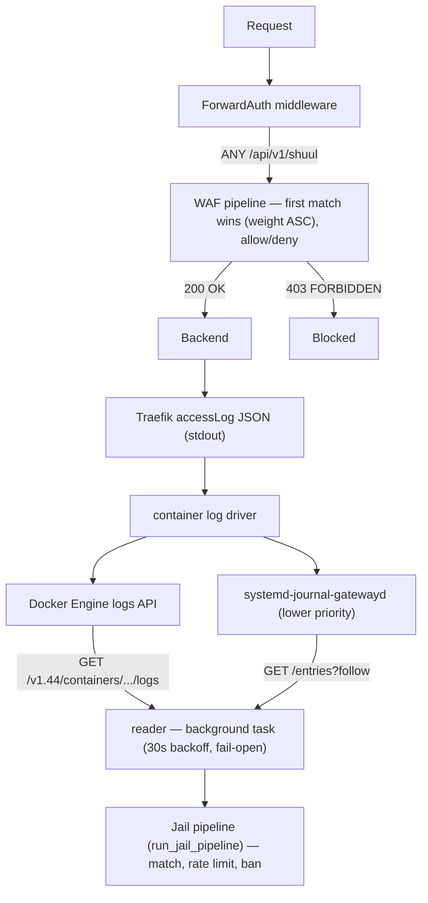
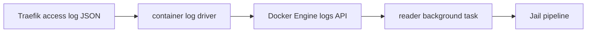

# Shuul

**The gatekeeper for your data** — WAF + fail2ban-style rate limiting for Traefik, powered by SQLite.

Shuul is a ForwardAuth service for Traefik that evaluates incoming requests against a configurable set of rules (WAF pipeline) and applies post-factum rate limiting based on backend HTTP response codes (Jail pipeline). It ships with a full React admin dashboard and 80+ preconfigured rule templates, and it plugs into Traefik with a ForwardAuth middleware — the Jail pipeline is fed from Traefik's own access logs, streamed from the Docker Engine log API by a background reader (`systemd-journal-gatewayd` remains supported as a lower-priority backend).

---

## Architecture



### Two independent pipelines

| Pipeline | Source | Role | Behaviour |
|---|---|---|---|
| **WAF** | `ANY /api/v1/shuul` (ForwardAuth) | Intercept, match, allow/deny | First matching rule wins (by weight ASC). Safe paths, trusted IPs, and trusted UAs bypass all checks. |
| **Jail** | Traefik access logs via the **Docker Engine log API** (`systemd-journal-gatewayd` kept as a lower-priority backend), plus the legacy `POST /api/v1/report` | Post-factum rate limiter (fail2ban-style) | ALL matching rules count independently. Each rule with a rate limit profile is a separate "jail". |

Both sources feed exactly the same `run_jail_pipeline` function: the background reader calls it in-process, the HTTP endpoint calls it after deserializing the request body.

### How it works

1. **Traefik** receives an incoming request
2. **ForwardAuth** (`shuul-auth` middleware) sends the request to `ANY /api/v1/shuul`
3. **WAF pipeline** evaluates rules, returns 200 OK (allow) or 403 FORBIDDEN (deny)
4. If allowed, the request reaches your **backend**
5. After the backend responds, the **status code lands in Traefik's access log** (JSON format, on stdout; the container log driver decides where it is stored)
6. Shuul's **background reader** streams those entries from the **Docker Engine log API** (or from `systemd-journal-gatewayd` as a lower-priority backend) and turns each backend response into a report
7. **Jail pipeline** applies rate limiting to every report:
   - Matches against ALL jail rules
   - If `status_code ∈ fail_codes` → increments the rate limiter counter
   - If threshold exceeded → bans the IP
8. The banned IP receives 403 on subsequent WAF checks

---

## Features

### Rule Engine (WAF)

- 14 filter fields: IP, FQDN, path, query, country, user-agent, method, referer, content-type, accept-language, x-request-id, protocol, city, country code
- Regex patterns for flexible matching
- Weight-based priority (lower weight = evaluated first)
- Three modes: `enforce` (block if not allowed), `log_only` (log but don't block), `off` (ignore)
- `allow` / `deny` actions
- Pipeline classification: WAF (filtering only), Jail (rate limiting), or Both
- Safe paths, trusted IPs, and trusted User-Agent bypass lists

### Rate Limiting (Jail — fail2ban-style)

- **Post-factum**: rate limiting happens AFTER the backend responds — zero latency impact on the request path
- **Fed from Traefik's access logs**: the background reader streams them from the Docker Engine log API (or `systemd-journal-gatewayd` as a lower-priority backend), so no per-request HTTP call to shuul is needed
- **Multiple independent jails**: each matching rule is evaluated independently with its own rate limit profile
- **fail_codes**: only specific HTTP status codes count as failures (e.g., `[401, 403, 404]`)
- Sliding window counter per IP per profile
- Configurable ban duration with escalation (multipliers `[1, 2, 4, 8]`)
- Ban count decay over configurable days
- Circular ring-buffer implementation for O(1) rate limit checks

### Reader (Jail observation source)

- Background task that streams Traefik access logs from the **Docker Engine log API**, over its Unix socket (`SHUUL_DOCKER_SOCKET`) or a TCP proxy (`SHUUL_DOCKER_URL`); `systemd-journal-gatewayd` is kept as a lower-priority backend
- Server-side filtering by container: by the `{container}` path segment on the Docker backend, by `CONTAINER_NAME` on gatewayd (default `traefik`)
- Only logs that reached a backend are accounted for: entries with `OriginStatus == 0` are discarded
- No history replay: each connection attempt cuts off the backlog, so nothing older is counted towards rate limiting
- Fail-open: if the backend is unreachable it retries every 30 s (`docker api not available` / `journald gateway not available`) and the WAF pipeline keeps working untouched
- Transport precedence: `SHUUL_DOCKER_SOCKET` → `SHUUL_DOCKER_URL` → `SHUUL_JOURNALD_SOCKET` → `SHUUL_JOURNALD_URL` → `http://localhost:19531`; the container is `SHUUL_DOCKER_CONTAINER`, falling back to `SHUUL_JOURNALD_CONTAINER` and then `traefik`
- Mode B (`docker-socket-proxy`) needs no host permissions; mode A mounts `/var/run/docker.sock`, which is **equivalent to root on the host** even with `:ro`
- `systemd-journal-gatewayd` (Debian/Ubuntu: package `systemd-journal-remote`) is only needed if you use the journald backend; restrict port `19531` to your Docker bridge subnets

### Dashboard (React SPA)

- **Dashboard**: overview with rule counts, request totals, active bans, security checklist
- **Rules**: full CRUD with 4-tab editor (General, Network, Location, Request)
- **Rate Limit Profiles**: full CRUD with escalation configuration
- **Bans**: active ban table with manual ban/unban
- **Templates**: 80+ preconfigured rule templates in 3 categories (WAF, Jail, Rate Limit Profiles)
- **Charts**: time-series evolution (stacked bar, line, by-method), rankings (countries, rules, methods, paths, FQDNs) as donut charts
- **Settings**: global configuration (safe paths, trusted IPs, trusted UAs, log level)
- **Logs**: real-time event viewer with WAF/Jail audit trail, configurable ring buffer (1K–20K entries), event type filtering, auto-refresh
- **Dark/light mode** with persisted preference
- **i18n**: Spanish, Valencian, English
- SSO/OIDC authentication via PocketID

### GeoIP

- MaxMind GeoLite2 City database integration
- City, country name, and country code matching
- moka LRU cache (10k entries, 1h TTL) for performance
- Block traffic from specific countries

### Templates Library

81 preconfigured rule templates and 9 rate limit profile templates for:

- **CMS**: WordPress (wp-login, xmlrpc, wp-admin), Drupal, Joomla, Magento, PrestaShop
- **Cloud**: Nextcloud, Home Assistant
- **Auth**: phpMyAdmin, Webmin, Jenkins, Grafana, Portainer, Kubernetes Dashboard
- **Email**: Roundcube, RainLoop, SnappyMail
- **Security**: Known bots, scanners, Log4j, SSTI, SQL injection, XSS, path traversal
- **API**: Generic login/token, OAuth callbacks, GraphQL
- **Infrastructure**: Traefik, Kibana, pgAdmin, Mailpit, Mailhog

### Export / Import

- Export all rules as JSON (`GET /api/v1/rules/export`)
- Import rules from JSON with upsert by name (`POST /api/v1/rules/import`)
- Useful for backup, migration, or CI/CD

### Data Storage

- **SQLite** — single file, zero administration
- Stats snapshot persisted every 30 minutes (survives restarts)
- Bans persisted to database immediately
- Settings stored as key-value pairs
- No external database server required

---

## Quick Start

### Prerequisites

- Docker and Docker Compose
- Traefik v3.x configured as reverse proxy
- An OIDC provider (e.g., [PocketID](https://github.com/atareao/pocketid))
- MaxMind GeoLite2 City database (optional, for GeoIP features)

### 1. Environment Variables

| Variable | Required | Default | Description |
|---|---|---|---|
| `SECRET` | ✅ | — | JWT signing secret (random string, minimum 32 chars) |
| `OIDC_ISSUER_URL` | ✅ | — | OIDC issuer URL (e.g., `https://auth.example.com`) |
| `OIDC_CLIENT_ID` | ✅ | — | OIDC client ID |
| `OIDC_CLIENT_SECRET` | ✅ | — | OIDC client secret |
| `OIDC_REDIRECT_URL` | ❌ | `http://localhost:3000/api/v1/auth/callback` | OIDC callback URL |
| `DATABASE_URL` | ❌ | `sqlite:///app/data/shuul.db?mode=rwc` | SQLite database path |
| `PORT` | ❌ | `3000` | HTTP listen port |
| `MAXMIND_DB_PATH` | ❌ | `geo/GeoLite2-City.mmdb` | Path to GeoIP database |
| `SHUUL_DOCKER_SOCKET` | ❌ | — (unset) | Path of the Docker socket; activates the **Docker API** over `AF_UNIX` (highest transport priority) |
| `SHUUL_DOCKER_URL` | ❌ | — (unset) | Base URL of a Docker API proxy over TCP; used only if `SHUUL_DOCKER_SOCKET` is unset |
| `SHUUL_DOCKER_CONTAINER` | ❌ | `traefik` | Container whose logs are read; falls back to `SHUUL_JOURNALD_CONTAINER`, then `traefik` |
| `SHUUL_JOURNALD_SOCKET` | ❌ | — (unset) | Path of the gatewayd socket (lower-priority journald backend) |
| `SHUUL_JOURNALD_URL` | ❌ | `http://localhost:19531` | Base URL of the `systemd-journal-gatewayd` endpoint (lower-priority backend) |
| `SHUUL_JOURNALD_CONTAINER` | ❌ | `traefik` | Container name matched against the journal's `CONTAINER_NAME` field |
| `RUST_LOG` | ❌ | `info` | Log level (trace, debug, info, warn, error) |

### 2. Run with Docker

```bash
# Create directories for persistent data
mkdir -p data geo

# Download MaxMind GeoLite2 database (optional)
# Place GeoLite2-City.mmdb in geo/

# Copy and edit production environment
cp .env.prod.example .env
# Edit .env with your values

# Start
docker compose up -d
```

### 3. First Access

1. Open `https://shuul.yourdomain.com` in your browser
2. Click "Sign in with PocketID"
3. After SSO authentication, you'll be redirected to the admin dashboard
4. Go to **Templates** to apply preconfigured rules
5. Configure **Settings** for safe paths and trusted IPs

### 4. Traefik Configuration

**Only the ForwardAuth middleware is required.** Add it to your dynamic config:

```yaml
# dynamic.yml
http:
  middlewares:
    shuul-auth:
      forwardAuth:
        address: "http://shuul:3000/api/v1/shuul"
        trustForwardHeader: true

  routers:
    my-service:
      middlewares:
        - shuul-auth   # ForwardAuth (allow/deny)
```

The Jail pipeline reads the status codes from Traefik's access logs, so Traefik must write them in JSON format and leave them on stdout (do **not** set `accessLog.filePath`):

```yaml
# traefik.yml (static)
accessLog:
  format: json
  # Do NOT set filePath: leave access logs on stdout so the container log driver captures them
```

The reader then reads those logs from the **Docker Engine log API**. The container's log driver must be one of `json-file`, `local` or `journald`:

```yaml
# compose.yml of the Traefik stack — any of json-file / local / journald works
services:
  traefik:
    logging:
      driver: journald
```

The recommended setup (mode B) puts a `docker-socket-proxy` in front of the Docker socket and points shuul at it over an internal network, so shuul needs no permission on the host:

```yaml
# compose.yml of the shuul stack — mode B (recommended)
services:
  docker-socket-proxy:
    image: <a docker-socket-proxy image of your choice>
    environment:
      - CONTAINERS=1                # only what the log API needs
    volumes:
      - /var/run/docker.sock:/var/run/docker.sock:ro
    networks: [internal]
  shuul:
    environment:
      - SHUUL_DOCKER_URL=http://docker-socket-proxy:2375
      - SHUUL_DOCKER_CONTAINER=traefik
    networks: [internal, proxy]     # `proxy` is the network Traefik shares with shuul
```

The direct-socket alternative (mode A) sets `SHUUL_DOCKER_SOCKET=/var/run/docker.sock`, mounts the socket read-only and adds the host's numeric `docker` group gid to `group_add` — but be aware that mounting the Docker socket is **equivalent to root on the host**, even with `:ro`. Both modes, and the `tty: true` prohibition, are documented in [SELF-HOSTING.md](SELF-HOSTING.md) §2.13.

If you instead keep the **journald backend** (lower priority), install the gateway package, enable it and point shuul at it. With the `journald` driver the Docker API already serves the same logs, so this is only needed when you deliberately do not use the Docker backend:

```bash
sudo apt install -y systemd-journal-remote          # Debian/Ubuntu: separate package
sudo systemctl enable --now systemd-journal-gatewayd.socket
```

```yaml
# compose.yml of the shuul stack — journald fallback
services:
  shuul:
    extra_hosts:
      - "host.docker.internal:host-gateway"
    environment:
      - SHUUL_JOURNALD_URL=http://host.docker.internal:19531
      - SHUUL_JOURNALD_CONTAINER=traefik
```

Keep the journal in RAM if you want zero disk writes:

```ini
# /etc/systemd/journald.conf.d/volatile.conf
[Journal]
Storage=volatile
```

`systemd-journal-gatewayd` has **no authentication** — never expose port `19531` publicly; allow it only from your Docker bridge subnets. See [SELF-HOSTING.md](SELF-HOSTING.md) for the full setup, firewall rules, and troubleshooting.

> **Deprecated — the `shuul-reporter` Traefik plugin is no longer the recommended path.** It still works for existing deployments (it keeps posting to `POST /api/v1/report`), but new installations should use the background reader (Docker backend). Its static config was:
>
> ```yaml
> experimental:
>   plugins:
>     shuul-reporter:
>       moduleName: github.com/atareao/traefik-shuul-reporter
>       version: v0.1.0
> ```
>
> ...and the router then chained `shuul-auth` + `shuul-reporter`, the latter with `shuulUrl: "http://shuul:3000/api/v1/report"` and `timeoutMs: 500`.

---

## API Reference

All endpoints are prefixed with `/api/v1`. Protected endpoints require a Bearer JWT token in the `Authorization` header.

### Public Endpoints (no auth)

| Method | Path | Description |
|---|---|---|
| `ANY` | `/shuul` | **WAF** — ForwardAuth: validate and filter request |
| `POST` | `/report` | **Jail** — Receive a backend status code report (deprecated plugin path; the background reader calls the same pipeline in-process) |
| `GET` | `/health` | Health check |
| `GET` | `/util/complete?ip=` | GeoIP lookup for a single IP |
| `GET` | `/auth/sso` | OIDC SSO redirect |
| `GET` | `/auth/callback` | OIDC callback |
| `GET` | `/auth/sso-status` | SSO configuration status |
| `GET` | `/templates` | List predefined rule and profile templates |

### Protected Endpoints (JWT required)

| Method | Path | Description |
|---|---|---|
| `GET` | `/rules` | List rules (paged, sortable, filterable) |
| `POST` | `/rules` | Create rule |
| `PATCH` | `/rules` | Update rule |
| `DELETE` | `/rules?id=` | Delete rule |
| `GET` | `/rules/export` | Export all rules as JSON |
| `POST` | `/rules/import` | Import rules from JSON (upsert by name) |
| `GET` | `/rules/info?option=` | Rule count (total, active) |
| `GET` | `/rules/info/all` | Total + active rule counts |
| `GET/POST` | `/rate-limit-profiles` | List / Create profiles |
| `PATCH` | `/rate-limit-profiles` | Update profile |
| `DELETE` | `/rate-limit-profiles?id=` | Delete profile |
| `GET` | `/rate-limit-profiles/info?option=total` | Profile count |
| `GET` | `/bans` | List active bans (paged, sortable) |
| `POST` | `/bans` | Manually ban an IP |
| `DELETE` | `/bans?id= or ?ip_address=` | Unban IP |
| `GET` | `/bans/info` | Active ban count |
| `GET/PUT` | `/settings` | Get / Update global settings |
| `GET` | `/stats/info` | Stats summary (allowed, blocked totals) |
| `GET` | `/stats/top_countries` | Top 10 blocked countries |
| `GET` | `/stats/top_rules` | Top 10 blocking rules |
| `GET` | `/stats/top_methods` | Top 10 HTTP methods |
| `GET` | `/stats/top_paths` | Top 10 request paths |
| `GET` | `/stats/top_fqdns` | Top 10 FQDNs |
| `GET` | `/stats/evolution?unit=&last=` | Time-series blocked/allowed |
| `GET` | `/stats/evolution_by_method?unit=&last=` | Time-series per HTTP method |
| `GET` | `/logs` | List log entries from in-memory ring buffer |
| `PUT` | `/logs/capacity` | Change log buffer capacity (`1000`, `5000`, `10000`, `20000`) |

### WAF Endpoint (`ANY /api/v1/shuul`)

Called by Traefik as ForwardAuth for every incoming request.

**Response:** `200 OK` (allow) or `403 FORBIDDEN` (deny)

**Logic:**
1. Safe paths → ALLOW (bypass all checks)
2. Trusted IPs → ALLOW (bypass all checks)
3. Trusted User-Agents → ALLOW (bypass all checks)
4. Banned IP → 403 FORBIDDEN
5. Match against rules (first match wins by weight ASC):
   - `mode = "off"` → skip
   - `mode = "log_only"` → allow=true
   - `mode = "enforce"` → apply allow/deny
6. 200 OK or 403 FORBIDDEN

**No rate limiting is evaluated in this endpoint.**

### Report Endpoint (`POST /api/v1/report`)

Legacy HTTP entry point to the Jail pipeline, called by the deprecated `traefik-shuul-reporter` plugin. Always returns 200 OK (fire-and-forget). New deployments feed the Jail pipeline through the background reader, which invokes the very same pipeline in-process — this endpoint remains for backwards compatibility.

```json
{
  "ip_address": "192.168.1.100",
  "status_code": 401,
  "path": "/wp-login.php",
  "method": "POST"
}
```

**Logic:**
1. Match IP/path/method against ALL active rules
2. For each matching rule with `rate_limit_profile_id`:
   - Load the rate limit profile
   - Check if `status_code` is in the profile's `fail_codes`
   - If yes → increment rate limiter counter for that IP
   - If threshold exceeded → ban the IP
3. Always returns 200 OK

### Reader (Jail observation source)

The recommended way to feed the Jail pipeline. A background task streams Traefik's access logs from the **Docker Engine log API**:

```
GET {SHUUL_DOCKER_URL or SHUUL_DOCKER_SOCKET}/v1.44/containers/{SHUUL_DOCKER_CONTAINER}/logs?follow=1&stdout=1&stderr=1&tail=0&timestamps=1&since=<epoch>
Accept: application/json          # Docker raw-stream, multiplexed into 8-byte frames
```

**Logic:**
1. Read the multiplexed stream incrementally: an 8-byte header (stream id, padding, big-endian length) followed by the payload, keeping the decoder state across chunks
2. Keep only `stdout` frames; `stderr` is dropped at `debug`
3. Strip the leading RFC3339 timestamp (`timestamps=1`), then parse the rest as Traefik access log JSON
4. Discard lines with `OriginStatus == 0` (or missing, or without a client IP): the request never reached a backend
5. Hand every remaining line to the Jail pipeline as a `ReportPayload`

Each connection attempt cuts off the history (the `since` filter is only a coarse, one-second hint), so a restart never replays the backlog. If the backend is unavailable the reader logs `docker api not available` and retries every 30 s. The WAF pipeline is never affected.

The `systemd-journal-gatewayd` backend (lower priority) uses `GET /entries?follow&CONTAINER_NAME={SHUUL_JOURNALD_CONTAINER}`, keeps its position with `__CURSOR`, and is selected only when no `SHUUL_DOCKER_*` variable is set.

### Rule Export / Import

**Export:** `GET /api/v1/rules/export`
```json
{
  "status": 200,
  "message": "OK",
  "data": [ { "id": 1, "name": "WordPress - wp-login", ... } ]
}
```

**Import:** `POST /api/v1/rules/import`
```json
{
  "rules": [ { "name": "WordPress - wp-login", "path": "^/wp-login\\.php", ... } ]
}
```

Rules are upserted by `name` — existing rules with the same name are replaced.

---

## Rate Limit Profiles

### Default Profiles (shipped with the application)

| ID | Name | Max Retry | Window | Ban Time | Escalate | Fail Codes |
|---|---|---|---|---|---|---|
| 1 | Auth Brute Force | 5 | 300s | 900s | Yes | 401 |
| 2 | Admin Guard | 5 | 300s | 3600s | Yes | 401, 403 |
| 3 | Path Scanning | 20 | 60s | 300s | Yes | 403, 404 |
| 4 | API Abuse | 100 | 60s | 300s | Yes | 401, 403, 429 |
| 5 | Scraping | 60 | 60s | 300s | Yes | 403, 429, 500 |
| 6 | Health & Webhooks | 100 | 60s | 60s | No | 500, 502, 503 |
| 7 | Recidive | 3 | 172800s | 604800s | Yes | 403, 429 |
| 8 | Global Shield | 300 | 60s | 300s | Yes | 403, 404, 429, 500, 502, 503 |
| 9 | Scanner Aggressive | 50 | 10s | 1800s | Yes | 403, 404, 405, 500 |

### Profile Fields

| Field | Type | Description |
|---|---|---|
| `max_retry` | int | Max failures before ban |
| `find_time_seconds` | int | Sliding window duration (seconds) |
| `ban_time_seconds` | int | Initial ban duration (seconds) |
| `bantime_increment` | bool | Enable ban escalation on repeat offences |
| `bantime_multipliers` | int[] | Escalation multipliers (default: `[1, 2, 4, 8]`) |
| `bantime_maxtime_seconds` | int | Maximum ban duration cap |
| `ban_count_decay_days` | int | Days before ban count resets |
| `fail_codes` | int[] | HTTP status codes that count as failures |

### fail_codes

The `fail_codes` field is what makes shuul unique. Instead of counting every request, you define which HTTP response codes count as "failures":

- **401 Unauthorized** — Failed login / missing auth
- **403 Forbidden** — Access denied (by backend or WAF)
- **404 Not Found** — Scanner probing non-existent paths
- **429 Too Many Requests** — Backend rate limit
- **500/502/503** — Backend errors (anti-scraping, resource abuse)

---

## Feeding the Jail Pipeline

The Jail pipeline needs to know which status codes your backends returned. Shuul supports two observation sources, and both hand the result to the same `run_jail_pipeline` function.

### Recommended: Docker backend (Engine log API)



Shuul streams the logs from the Engine (`GET /v1.44/containers/{container}/logs?follow`), demodulates the 8-byte frame headers, strips the per-line timestamp, and turns every access log that reached a backend into a report — which is how it knows:

- "This IP got 5 login failures in 10 minutes" (401)
- "This IP is scanning for PHP files" (404)
- "This IP is scraping aggressively" (429)

Entries with `OriginStatus == 0` never reached a backend (the answer came from routing or a middleware) and are discarded, so they don't count as failures. There is no extra HTTP call per request, and if the backend goes down the reader just retries every 30 s while the WAF keeps working. Setup: **Quick Start → 4. Traefik Configuration**. The `systemd-journal-gatewayd` backend is still supported as a lower-priority alternative.

### Deprecated: `traefik-shuul-reporter` plugin

The [traefik-shuul-reporter](https://github.com/atareao/traefik-shuul-reporter) plugin was the original bridge between the backend response and shuul. It still works, and existing deployments can keep using it, but it is **no longer the recommended path** — it adds an HTTP `POST` per response plus a 500 ms timeout, while the background reader reuses Traefik's own access logs for free.

### How the plugin works

```mermaid
Backend response → Plugin wraps ResponseWriter
                    captureWriter.WriteHeader(401)
                    Extract IP from X-Forwarded-For
                    POST /api/v1/report (async goroutine)
                    shuul evaluates: status_code ∈ fail_codes?
```

The plugin intercepts `WriteHeader()` on the Go response writer, extracts the client IP, and sends an async POST to shuul's report endpoint — zero latency impact on the response. Both this path and the background reader ultimately run the same Jail logic.

---

## Development

### Backend (Rust / Axum)

```bash
cd backend
cargo check               # Verify compilation
cargo build               # Build binary
cargo test                # Run tests
cargo clippy              # Lint
cargo fmt                 # Format code

# Run backend only (frontend must be built first)
RUST_LOG=debug cargo run
```

### Frontend (React / TypeScript / Vite)

```bash
cd frontend
pnpm install              # Install dependencies
npx tsc --noEmit          # Type-check
pnpm run dev              # Dev server (Vite, port 5173)

# Build for production
pnpm build                # Outputs to dist/
```

### Full Stack (via just)

```bash
just frontend     # Dev server (Vite, port 5173)
just backend      # Run backend
just dev          # Build frontend + copy + run backend
just build        # Build Docker image
```

`backend/static` es un artefacto generado por `just dev`: no se versiona.

### Database

SQLite — single file, zero configuration. Migrations run automatically on startup:

```bash
backend/migrations/
├── 20260902000000_initial_schema.up.sql      # Full initial schema
├── 20260903000000_add_log_all_requests_setting.up.sql
├── 20260903000001_update_rate_limit_profiles.up.sql
└── 20260903000002_add_scanner_aggressive_profile.up.sql
```

---

## Rule Types (UI Classification)

Each rule in the frontend is classified by type:

| Type | Badge | Condition | Example |
|---|---|---|---|
| **WAF** | 🔵 Blue | Has filters but **no** rate limit profile | Block requests from China |
| **Jail** | 🟢 Green | Has rate limit profile but **no** filters | Rate limit 100/600s all traffic |
| **WAF + Jail** | 🟣 Purple | Has both filters AND rate limit profile | Block `/api/login` + rate limit 5/60s |

---

## Security Checklist

1. ✅ Set a strong `SECRET` (minimum 32 random characters)
2. ✅ Configure OIDC with a proper identity provider
3. ✅ Apply WAF templates for your exposed services
4. ✅ Configure safe paths for health checks and webhooks
5. ✅ Set trusted IPs for your internal networks
6. ✅ Review rate limit profiles and adjust thresholds
7. ✅ Enable GeoIP blocking for countries with no business traffic
8. ✅ Test with `log_only` mode before switching to `enforce`

---

## Upgrading

Shuul uses SQLite with automatic migrations. To upgrade:

```bash
# Pull new image
docker compose pull

# Restart (migrations run automatically)
docker compose up -d
```

For major version upgrades, check the [releases page](https://github.com/atareao/shuul/releases).

---

## License

MIT