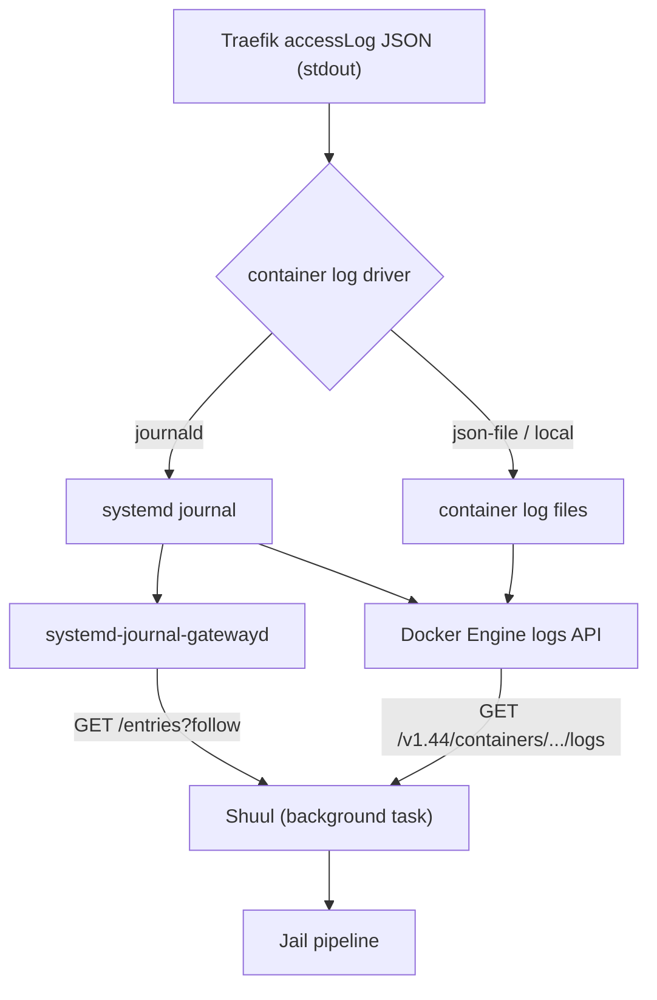

# Self-Hosting Guide — Shuul

This guide walks you through deploying shuul on your own infrastructure. Shuul is designed to run as a Docker container alongside Traefik, protecting your services with WAF filtering and fail2ban-style rate limiting.

---

## Prerequisites

- **Docker + Docker Compose** (or Podman with podman-compose)
- **Traefik v3.x** running as a reverse proxy
- **An OIDC provider** (recommended: [PocketID](https://github.com/atareao/pocketid))
- **MaxMind GeoLite2 City database** (optional, for GeoIP features)
- A domain name pointed to your Traefik instance

---

## 1. Traefik Setup

### 1.1 Enable the shuul-reporter plugin

**Deprecated — use the background reader instead.** The `traefik-shuul-reporter` plugin is deprecated. The recommended way to feed shuul's Jail pipeline is now the reader described in **section 2**, which streams Traefik's access logs from the **Docker Engine log API** (a socket or a TCP proxy) instead of receiving an HTTP `POST` per request; the `systemd-journal-gatewayd` backend is kept as a lower-priority alternative. It removes the extra HTTP call per request and the plugin's 500 ms timeout. The plugin still works, and the configuration below remains valid for existing deployments, but it is no longer the recommended path — new installations should not use it.

Add this to your Traefik static configuration (`traefik.yml`):

```yaml
experimental:
  plugins:
    shuul-reporter:
      moduleName: github.com/atareao/traefik-shuul-reporter
      version: v0.1.0
```

### 1.2 Create the middleware chain

In your Traefik dynamic configuration (or provider), add:

```yaml
http:
  middlewares:
    shuul-auth:
      forwardAuth:
        address: "http://shuul:3000/api/v1/shuul"
        trustForwardHeader: true
        maxResponseBodySize: 1024

    shuul-reporter:
      plugin:
        shuul-reporter:
          shuulUrl: "http://shuul:3000/api/v1/report"
          timeoutMs: 500
          reportClientIP: true
```

`trustForwardHeader` and `maxResponseBodySize` are not optional details: without them Traefik warns at startup and leaves the trust model undecided. See **§1.4** for what they mean and for the order in which they must be applied — **first** shuul has to resolve the client address to a single value, **then** the deployment may declare which forwarding headers it trusts. Enabling the trust first lets a client pick the address shuul bans on.

### 1.4 Harden the deployment before trusting the forwarding headers

Three things have to be right for shuul to see the **real** client address. Do them in this order.

**1. shuul must resolve the address to a single value.** `X-Forwarded-For` is a **chain**, not a value: a client can prepend entries of its own. shuul resolves it to exactly one address — the **last** element, the one the nearest hop observed, which is the same address the Jail pipeline derives from Traefik's access log. If those two disagreed, bans would be recorded against one address and checked against another, and they would never apply. An element that cannot be resolved leaves the address empty, and shuul logs the discarded value at `DEBUG` level (`RUST_LOG=backend=debug`). **Upgrade before doing step 2** — and keep an eye on the logs afterwards: if the client address suddenly stops resolving, step 2 is the first place to look.

**Why the last element is the right one.** Traefik *appends* the address of the peer it observed to the `X-Forwarded-For` it forwards: the option that would stop it, `notAppendXForwardedFor`, defaults to `false`. So the last element is the nearest hop — and the same address the Jail pipeline reads from the access log. This holds **only while `forwardedHeaders.trustedIPs` stays empty**: with Traefik as the edge it drops the client's own `X-Forwarded-For` and appends the real client, leaving a one-element chain. Add a trusted upstream proxy to `trustedIPs` and the chain grows — Traefik keeps what it receives and appends its own peer — so the last element becomes the proxy and the client moves to the first. If you ever introduce one, revisit this: the address shuul checks and the one the access log records have to keep agreeing.

**2. Then declare who you trust.** Traefik is your edge, so nobody upstream is trusted. On the entry point:

```yaml
entryPoints:
  websecure:
    address: ":443"
    forwardedHeaders:
      trustedIPs: []
```

and on the forwarding-auth middleware, as shown in §1.2:

| Option | What it does | Left unset |
|---|---|---|
| `forwardedHeaders.trustedIPs` | The entry point strips `X-Forwarded-*` from clients that are **not** on the list. With Traefik as the edge the list stays empty, so every client-supplied forwarding header is dropped. | Nothing is stripped upstream |
| `trustForwardHeader` | Whether the forwarding-auth middleware keeps the `X-Forwarded-*` headers it receives. It takes effect **only** once the entry point has sanitised them. | Traefik warns and behaves inconsistently: it strips some headers and forwards others untouched |
| `maxResponseBodySize` | Bounds the response Traefik reads back from shuul. | Unlimited, and Traefik warns |

> The option is spelled **`trustForwardHeader`**. A `trustForwarders` option does not exist: Traefik ignores it silently, the startup warning stays, and the trust model is left undecided.

**3. Reject the headers whose names alias another header.** Go canonicalises header names on **dashes only**, so `X-Auth-User`, `X_Auth_User` and `X.Auth.User` are three different headers for Traefik — and the same `HTTP_X_AUTH_USER` variable for a backend that derives its variable names from header names (CGI, WSGI, PHP, NGINX). A client can therefore send an alias of a header Traefik manages and have your backend read the alias instead. Set this on every entry point fronting such a backend:

```yaml
entryPoints:
  websecure:
    address: ":443"
    http:
      aliasHeadersStrategy: delete
```

`delete` removes any request header whose name contains a character that is neither a letter, a digit nor a dash; `reject` answers `400 Bad Request` instead. The default is `keep`, which preserves the current behaviour, and Traefik warns at startup for every entry point left without the option.

**4. Decide about encoded characters — carefully.** Since v3.6.7 Traefik **allows** `%2F`, `%5C`, `%00`, `%3B`, `%25`, `%3F` and `%23` in the request path by default. Allowing them invites a *split view*: the proxy and the backend can read the same URL differently, and that difference is a bypass. If your backends are RFC 3986 compliant:

```yaml
entryPoints:
  websecure:
    address: ":443"
    http:
      encodedCharacters:
        allowEncodedSlash: false
        allowEncodedBackSlash: false
        allowEncodedNullCharacter: false
        allowEncodedSemicolon: false
        allowEncodedPercent: false
        allowEncodedQuestionMark: false
        allowEncodedHash: false
```

> This covers the **request path only, never the query string**. It is also the one setting here that can break a working service: a backend that legitimately expects an encoded slash starts answering `400`. Enable it and then test.

**5. Bound the request headers.** shuul inspects the headers of every request, so an unbounded header set is an unbounded input. `maxHeaderBytes` caps it. Note that from v3.7.17 on Traefik is built with Go 1.27, which also caps the number of header **values** at 500 and answers `431 Request Header Fields Too Large` — and because those requests are rejected **before** routing, they never reach the access log and the Jail pipeline never sees them.

### 1.3 Attach middleware to your routers

For each service you want to protect:

```yaml
http:
  routers:
    my-app:
      rule: "Host(`app.example.com`)"
      service: my-app
      middlewares:
        - shuul-auth      # 1st: ForwardAuth (WAF)
        - shuul-reporter  # 2nd: Status code reporting (Jail)
      tls: {}
```

**Why this order:** The WAF middleware runs first to deny malicious requests before they reach your backend. After your backend responds, the reporter plugin captures the status code and sends it to shuul's Jail pipeline.

---

## 2. Feeding the Jail pipeline with Traefik access logs

The Jail pipeline (fail2ban-style rate limiting) needs to observe the status codes your backends return. The legacy `shuul-reporter` Traefik plugin pushed those observations to `POST /api/v1/report`; the current design **pulls** them instead, streaming Traefik's access logs straight from the Docker Engine log API — or, as a lower-priority alternative kept for existing deployments, from the systemd journal through `systemd-journal-gatewayd`:



This removes the extra HTTP call per request, the plugin's 500 ms timeout, and any continuous access-log write to disk. The WAF pipeline is unaffected.

> ⚠️ **What you gain and what you do not.** With the `journald` log driver — the one this guide has always assumed, see 2.1 — the Docker API serves the logs, but **the journal is still underneath**: the Engine reads the journal (as root) to answer the API. What disappears when you switch to the Docker backend is `systemd-journal-gatewayd`, the `/run/systemd/journal` mount and its `group_add`; it is **not** a way to get rid of the journal. Only if you also moved Traefik's log driver to `json-file` would journald leave the path entirely.

### Two backends, four transports

Shuul picks the transport from the environment, in this order — the first variable that is **defined and non-blank** wins, and a blank value counts as unset:

1. `SHUUL_DOCKER_SOCKET` → **Docker API** over the Unix socket
2. `SHUUL_DOCKER_URL` → **Docker API** over TCP (a proxy)
3. `SHUUL_JOURNALD_SOCKET` → **gatewayd** over the Unix socket
4. `SHUUL_JOURNALD_URL` → **gatewayd** over TCP
5. otherwise → **gatewayd** over TCP at `http://localhost:19531`

Both TCP URLs accept `tcp://` as a **synonym** of `http://` — it is an alias of the same transport, not a variant, so `SHUUL_DOCKER_URL=tcp://proxy:2375` and `SHUUL_DOCKER_URL=http://proxy:2375` are interchangeable and the startup line always shows the effective `http` scheme.

Within one backend the socket beats its own URL and shuul logs a warning naming the ignored URL. Because the Docker backend outranks the journald one, any `SHUUL_DOCKER_*` variable automatically disables the gatewayd path — which is what makes the rollback in 2.14 a matter of unsetting variables.

The container whose logs are read is `SHUUL_DOCKER_CONTAINER`, falling back to `SHUUL_JOURNALD_CONTAINER` and then to `traefik`.

#### Mode A (direct socket) versus mode B (TCP proxy)

Both modes feed the same Docker API with the same request; they differ only in how shuul reaches it. Mounting the Docker socket is a **deliberate reversal** of an earlier decision in this project, which had rejected it as equivalent to root on the host; the risk is only accepted in the smaller-surface variant (the proxy), and the other is documented for whoever prefers to skip the extra container.

| | Mode A — direct socket | Mode B — TCP proxy (recommended) |
|---|---|---|
| Configuration | `SHUUL_DOCKER_SOCKET=/var/run/docker.sock` + the socket bind mount + `group_add` with the host's `docker` gid | `SHUUL_DOCKER_URL=http://docker-socket-proxy:2375` (or `tcp://docker-socket-proxy:2375`) + a `docker-socket-proxy` with `CONTAINERS=1` and everything else at `0`, on an internal network |
| Permissions it needs | The host's `docker` group | None on the host: only talking to the proxy over the internal network |
| Real risk | The container can talk to **the whole Engine** — mounting the socket is equivalent to root on the host | Only what the proxy allows; everything else is blocked |
| Cost | No extra pieces | One more container in the stack |
| How to revoke it | Remove the mount and recreate | Stop the proxy |

Both modes are documented in **2.13**; 2.1–2.12 keep documenting the gatewayd fallback. Switching between A and B — or back to gatewayd — is two environment variables and one `compose.yml` block: **never a rebuild**.

> **Do not enable `tty: true` on the Traefik container.** Without a TTY the Engine multiplexes the stream into 8-byte frames that shuul decodes; with `tty: true` the stream arrives raw, without headers, so shuul would read JSON bytes as if they were a frame header. The reader detects it and drops the connection with a warning naming the cause, but the fix is simply not to set `tty`. See 2.13.

### At a glance: end-to-end checklist

The whole Jail feed, in the order it has to be done. Commands are abbreviated; the `Detail` column points to the section that explains them. The steps below describe the **gatewayd fallback**; the Docker backend in **2.13** replaces steps 2–6 (the gateway package, the socket drop-in and the journal tweaks) with a single stack change, and reads the same access logs without touching systemd.

| # | What | Command | Expected | Detail |
|---|---|---|---|---|
| 1 | Traefik writes JSON access logs to stdout, log driver `journald` | `docker inspect -f '{{.HostConfig.LogConfig.Type}}' traefik` | `journald` | 2.1 |
| 2 | Install the gateway package | `sudo apt install -y systemd-journal-remote` | `.socket`/`.service` units present | 2.2 |
| 3 | Serve gatewayd on the Unix socket | drop-in + `systemctl restart …gatewayd.socket` | `active (listening)` | 2.3 |
| 4 | Verify the socket | `ls -ln …/gatewayd.sock`, `curl … /machine` | `srw-rw---- … <gid>`, JSON | 2.3 |
| 5 | Verify the live stream | `curl -sN --unix-socket … "…/entries?follow&CONTAINER_NAME=traefik"` | one JSON object per line | 2.4 |
| 6 | *(optional)* Journal in RAM, drop the leftovers | `Storage=volatile` + `journalctl --vacuum-time=1s` | `/run/log/journal/…` | 2.6 |
| 7 | Mount the socket and add the group in the stack | `volumes:` + `group_add:` | — | 2.7 |
| 8 | **Recreate** the container, check the group | `docker compose up -d --force-recreate shuul` | gid listed in `groups=` | 2.7 |
| 9 | Confirm which endpoint the reader chose | `docker compose logs shuul \| grep "journald reader"` | `… from unix:/run/…` | 2.8 |
| 10 | Confirm end to end | Admin → Logs, event toggles `registered` / `pending` / `banned` | `jail` rows, tagged orange | 2.11 |
| 11 | TCP mode, only if the socket cannot be mounted | `SHUUL_JOURNALD_URL=http://…:19531` | `… from http://…` | 2.9 |
| 12 | Roll back | — | — | 2.12 |

Steps 1–6 belong to the **host** and are done once; steps 7–10 belong to the **stack** and are repeated on every deployment. **Recreating is not restarting:** `group_add` and `volumes` are fixed when the container is created, so a `restart` never picks up a change to either.

### 2.1 Prerequisites: Traefik access logs in JSON over journald

Traefik must emit access logs in JSON, and its container logs must reach the systemd journal. In Traefik's static configuration:

```yaml
accessLog:
  format: json
  # Do NOT set filePath: leave access logs on stdout so the container log driver captures them
```

In the `compose.yml` of the stack running Traefik:

```yaml
services:
  traefik:
    logging:
      driver: journald
```

With the `journald` log driver, every access-log line becomes a journal entry tagged with `CONTAINER_NAME=traefik` — the field shuul filters on. If your Traefik container is named differently, set `SHUUL_JOURNALD_CONTAINER` accordingly (see 2.8).

**Confirm the field shuul matches.** Docker prints the container name with a leading slash in some places and without it in others, so check both sides instead of assuming:

```bash
docker inspect -f '{{.Name}} {{.HostConfig.LogConfig.Type}}' traefik
# /traefik journald        ← the name carries a leading slash; the journal field does not

journalctl CONTAINER_NAME=traefik -n 3 --no-pager -o cat
```

Shuul compares `CONTAINER_NAME`, which is the **container name without the leading slash**. If `docker inspect` prints `/edge-proxy`, then the value to configure is `SHUUL_JOURNALD_CONTAINER=edge-proxy` — not `/edge-proxy`.

The `journalctl` output must be one JSON line per request. If it is plain text, `accessLog.format: json` is missing from Traefik's static configuration.

Two fields decide whether an entry is processed at all:

- **`ClientHost`** — the client IP. If it is missing or empty, the reader falls back to **`ClientAddr`** and strips the port (`[::1]:54321` becomes `::1`). If neither of them yields an address there is no IP to attribute the request to, and the entry is discarded.
- **`OriginStatus`** — the status code. If it is absent, cannot be converted to `u16`, or is `0`, the entry is discarded. `0` means Traefik never reached the backend, usually because the WAF already cut the request.

Everything else is mapped onto the fields a Jail rule can match:

| JSON field | Payload field / rule filter |
|---|---|
| `ClientHost` (or `ClientAddr`) | `ip_address` |
| `OriginStatus` | `status_code`, checked against the profile's `fail_codes` |
| `RequestPath` | split into `path` and `query` |
| `RequestMethod` | `method` |
| `RequestHost` | `fqdn` |
| `RequestScheme` | `protocol` |
| `request_User-Agent` | `user_agent` |
| `request_Referer` | `referer` |
| `request_Content-Type` | `content_type` |
| `request_Accept-Language` | `accept_language` |
| `request_X-Request-Id` | `x_request_id` |

The `request_*` keys keep that literal prefix — case and hyphen included — because those are exactly the keys Traefik writes in its JSON. They cover the per-request filters a Jail rule can use (`user_agent`, `referer`, `content_type`, `accept_language`, `x_request_id`), alongside `fqdn`, `protocol`, `path` and `method`; a header Traefik does not put in the access log simply cannot be matched by a rule.

**Note:** if Traefik runs as a systemd unit instead of a container there is no `CONTAINER_NAME` field. This design assumes the Docker/Podman `journald` log driver and is **not** supported in that case.

### 2.2 Install the gateway package

On Debian and Ubuntu, `systemd-journal-gatewayd` and its `.socket`/`.service` units live in a separate package — they are **not** part of the base `systemd` package:

```bash
sudo apt update && sudo apt install -y systemd-journal-remote
```

Other distributions:

- **Fedora / RHEL:** `sudo dnf install systemd-journal-remote`
- **Arch Linux:** the gatewayd units ship with the base `systemd` package (some derivatives also provide a separate `systemd-journal-remote` package).

### 2.3 Serve gatewayd over a Unix socket (journald backend, lower priority)

```bash
sudo systemctl enable --now systemd-journal-gatewayd.socket
```

The gateway is socket-activated: the `.socket` unit listens, and systemd starts `systemd-journal-gatewayd.service` on demand on the first connection.

On Debian/Ubuntu that unit listens on TCP `19531` only. Replace the listener with a filesystem socket so that **nothing is exposed over the network at all**. The drop-in below is portable: the empty assignment resets whatever the packaged unit declared, so it also works on distributions that already ship the Unix socket.

```bash
sudo mkdir -p /etc/systemd/system/systemd-journal-gatewayd.socket.d
sudo tee /etc/systemd/system/systemd-journal-gatewayd.socket.d/unix.conf >/dev/null <<'EOF'
[Socket]
ListenStream=
ListenStream=/run/systemd/journal/gatewayd.sock
SocketGroup=systemd-journal
SocketMode=0660
EOF
sudo systemctl daemon-reload
sudo systemctl restart systemd-journal-gatewayd.socket
```

What each line does:

- **The empty `ListenStream=` removes the inherited `19531` TCP listener.** A drop-in cannot delete a setting, and repeated assignments *append*, so an empty assignment is the only way to reset the list — the second line then becomes the sole address the unit listens on. After this, `ss -ltn | grep 19531` prints nothing and there is no port to firewall.
- **`ListenStream=/run/systemd/journal/gatewayd.sock`** is systemd's canonical path for this socket and the one the shipped `compose.yml` mounts.
- **`SocketGroup=systemd-journal`** makes the socket `root:systemd-journal` instead of `root:root`. This is required because the image does **not** run as root: the `Dockerfile` declares `USER app`, and that user has **uid 1000**. `systemd-journal` is the group the system already uses to mean "may read the journal", and 2.7 grants it to the container as a supplementary group. Without it the reader fails with `connect: Permission denied (os error 13)` — see 2.11.
- **`SocketMode=0660`** restricts the socket to its owner and its group. Note this is **not** systemd's default: `SocketMode=` defaults to `0666` (`systemd.socket(5)`), which would let any local account open the socket and read the whole journal. `0660` is chosen here so that only root and the `systemd-journal` group can connect. The mode alone is not enough — a `0660` socket without `SocketGroup` stays `root:root`, which is exactly the configuration this guide used to document and that failed with `EACCES`. Together, `SocketGroup=systemd-journal` and `SocketMode=0660` produce `root:systemd-journal 0660`.

Verify that the socket exists, has the expected owner, and answers:

```bash
ls -ln /run/systemd/journal/gatewayd.sock
# srw-rw---- 1 0 <gid> 0 ...   ← <gid> is the group id of systemd-journal

curl -s --unix-socket /run/systemd/journal/gatewayd.sock http://localhost/machine
```

`ls` must show a `srw-rw----` entry (leading `s` = socket) owned by uid `0` and the `systemd-journal` gid. The gid is **not fixed**: it depends on the distribution and on the order in which the system created its groups, so never copy a number from a guide — read the real value on your host with `getent group systemd-journal`. If the socket still shows gid `0` (`root`), the drop-in was not reloaded: run `daemon-reload` and restart the `.socket` unit again.

`/machine` returns a small JSON object describing the journal (machine id, boot id, hostname, version) and is the cheapest proof that the socket is alive. Over `AF_UNIX` the host name in the URL is meaningless — gatewayd ignores it — so `http://localhost/…` is fine.

### 2.4 Verify real-time reading

Snapshot — returns the entries currently in the journal for that container, then terminates:

```bash
curl -s --unix-socket /run/systemd/journal/gatewayd.sock \
  "http://localhost/entries?CONTAINER_NAME=traefik" \
  -H "Accept: application/json"
```

Live stream — stays open and prints new entries as they are written (like `journalctl -f`); it does **not** terminate on its own, stop it with Ctrl+C:

```bash
curl -sN --unix-socket /run/systemd/journal/gatewayd.sock \
  "http://localhost/entries?follow&CONTAINER_NAME=traefik" \
  -H "Accept: application/json"
```

`Accept: application/json` selects the Journal JSON Format: one self-contained JSON object per line (NDJSON), each carrying the entry fields (`MESSAGE`, `CONTAINER_NAME`, `__CURSOR`, `__REALTIME_TIMESTAMP`, …). The `CONTAINER_NAME=traefik` query parameter filters **server-side** (`KEY=match`), so only Traefik's entries are sent. Without `follow`, gatewayd returns the existing entries and closes the connection.

These are the same requests shuul makes — it may add a `Range` header when resuming after a reconnect, but treats it only as a hint: what gets processed and what gets skipped is decided client-side (see 2.5) — so if the live stream prints Traefik access logs here, the reader will receive them too.

### 2.5 What the reader does after a restart

The reader feeds the Jail pipeline only with entries written **after it starts its current connection attempt**. Everything that happened while shuul was down stays unobserved: it is never counted towards rate limiting. This is deliberate — it is the same behaviour the deprecated `traefik-shuul-reporter` plugin had, and it fits the fail-open design of the reader, since a reader that cannot connect is not an observer.

The cut exists because the rate limiter does not use journal timestamps. `RateLimiter::record()` stamps every observation with `Instant::now()`, so replaying the backlog at startup would attribute hours of old `404`s to the current instant. A single IP with a history of scanning would be banned seconds after the container comes up, with no new traffic to justify it. In practice:

- After restarting shuul you should **not** see a burst of `[PENDING]` / `[BANNED]` events in the first seconds; only traffic from that moment on counts.
- If you do see such a burst, you are running a build from before this cut-off was introduced.

**Why the filter is client-side.** Two `Range` behaviours of `systemd-journal-gatewayd` (systemd 249) contradict what its documentation suggests, which is why the reader cannot delegate this to the gateway:

- `Range: realtime=<timestamp>` is **ignored** when the request also carries `?follow` — the stream behaves as if the header had not been sent at all.
- `Range: entries=<cursor>:1` does **not** skip the cursor entry unless `num_entries` is present; the form that applies the skip is `entries=<cursor>:1:N`.

So the cut is enforced in the reader, by comparing each entry's `__REALTIME_TIMESTAMP` (microseconds) with the instant the connection attempt began and discarding anything older; re-delivered entries are dropped by comparing `__CURSOR` with the last cursor already processed. An entry without a numeric `__REALTIME_TIMESTAMP` is discarded as well.

The **Docker backend enforces the same cut by different means** — a coarse `since` filter on the server plus an exact comparison, in the reader, with the instant that precedes each line — and the differences that matter (the `since` granularity, the clock assumption) are in **2.13**. In both backends the cut is fixed **on every connection attempt**: a failed attempt moves it forward, and everything written during the outage stays uncounted.

### 2.6 Keep the journal in RAM (`Storage=volatile`)

By default journald uses `Storage=auto`: if `/var/log/journal` exists, it writes to disk as well. For a zero-disk-write setup, switch the runtime journal to volatile:

```ini
# /etc/systemd/journald.conf.d/volatile.conf
[Journal]
Storage=volatile
RuntimeMaxUse=64M
```

Then restart journald:

```bash
sudo systemctl restart systemd-journald
```

With `Storage=volatile`, the journal lives in `/run/log/journal` — a **tmpfs mount, i.e. RAM** — and nothing is persisted. `RuntimeMaxUse` caps how much RAM it may consume; raise it (e.g. `256M`) for high-traffic deployments.

**Is the volatile journal actually active?** `journalctl --disk-usage` does not answer this: it also adds up the files persisted *before* the change. The proof is the header of the journal in use:

```bash
journalctl --header | head -3
# File path: /run/log/journal/<machine-id>/system.journal    ← RAM, correct
# File path: /var/log/journal/<machine-id>/system.journal    ← disk, the volatile drop-in did not apply
```

`systemd-analyze cat-config systemd/journald.conf` shows which file contributes each value (it prints `# /path` before each one); if a later `[Journal]` section redefines `Storage=`, the last one wins.

**Delete the persisted files left behind.** When you switch to `Storage=volatile`, journald stops writing to `/var/log/journal` **but does not delete what was already there**, and since it no longer manages that directory it does not vacuum it either. Measured on a real host: with `Storage=volatile` and `RuntimeMaxUse=64M` active, `journalctl --disk-usage` still reported `Archived and active journals take up 2.0G in the file system`, because 2.1 GB sat in `/var/log/journal` frozen at the instant of the change. Those are access logs with paths, query strings and headers: if the point was not writing them to disk, they are still there.

```bash
# Confirm first that the ACTIVE journal is in /run (previous check), then release the old files:
sudo journalctl --vacuum-time=1s
sudo du -sh /var/log/journal        # must drop to kB
```

**Warning:** if the host had `Storage=auto` and `/var/log/journal` exists, that directory reappears on the next start of journald if the drop-in is lost — an update that moves it somewhere else, for instance. Re-run the header check above after updating systemd.

**Note:** `RuntimeMaxUse` is a target, not a hard wall — with `64M` configured, roughly 72 MB were observed in `/run/log/journal`, because journald rotates in 8 MB files and overshoots a little between rotations.

**journald rate limiting (this is the important one).** journald **drops messages** by default: `RateLimitBurst` is **10 000 messages per `RateLimitIntervalSec` = 30 s, per service**, and whatever is dropped is gone — a single `Suppressed N messages from …` warning is emitted and logging continues. For the Jail pipeline that is a silent blind spot: if a scan produces more than that volume, Traefik's access logs are thrown away and the rate limiter stops seeing real traffic for the rest of the interval.

Two details worth writing down:

1. **The bucket is shared by every container.** The limit applies per *sending service*, and with the `journald` log driver the sender is the Docker daemon: every container using that driver competes for the same quota, not one quota each.
2. **The effective burst is multiplied** by a factor that depends on the space available to the journal (table in `journald.conf(5)`: ≤1 MB → ×1, ≤16 MB → ×2, ≤256 MB → ×3, ≤4 GB → ×4, ≤64 GB → ×5, ≤1 TB → ×6). With `RuntimeMaxUse=64M` the factor is ×3, so the real cut is around 30 000 messages per 30 s — and that covers **every** log on the host, not just Traefik's.

How to detect it:

```bash
sudo journalctl --since "-1h" --no-pager | grep -i "Suppressed.*messages"
```

How to avoid it, in the same drop-in (two options, each with its trade-off):

```ini
[Journal]
Storage=volatile
RuntimeMaxUse=64M
# Option A: raise the quota (keeps the limit as a safety net)
RateLimitBurst=200000
# Option B: disable it altogether (0 in either value turns it off)
#RateLimitBurst=0
```

The honest trade-off: disabling rate limiting does not fill the disk — `RuntimeMaxUse` is still the real ceiling and the journal rotates — but a flood can fill the RAM reserved for the journal and evict useful entries earlier. Raising the quota is the reasonable compromise; disabling it is defensible when the journal lives in tmpfs and that tmpfs has a bounded size.

Remember that this change affects the **whole** journal on the host, not only shuul: it is an operations decision, not an application setting.

**Trade-off:** with volatile storage the journal is lost on host reboot, so there will be no Traefik access logs to read after a restart. This matches shuul's own behavior — its log viewer is an in-memory ring buffer that is dropped on container restart. Rate-limiting state itself lives in SQLite and is unaffected.

With `Storage=volatile` the journal is a bounded RAM buffer: if the host reboots or the buffer rotates, those entries disappear and the reader simply never sees them. That is consistent with the restart cut-off in 2.5 and does not affect the WAF in any way.

### 2.7 Mount the socket into the shuul container

The container has its own mount namespace, so the host's `/run/systemd/journal` is not visible inside it unless you bind-mount it. Mount the **directory** that contains the socket, read-only, and tell shuul where to find it:

```yaml
services:
  shuul:
    environment:
      - SHUUL_JOURNALD_SOCKET=/run/systemd/journal/gatewayd.sock
      - SHUUL_JOURNALD_CONTAINER=traefik
    group_add:
      - systemd-journal          # Docker: resolved from the host
      # - "982"                  # Podman: numeric gid, see below
    volumes:
      - /run/systemd/journal:/run/systemd/journal:ro
```

**The `group_add` is the permission that opens the socket.** The container runs as `app` (uid 1000, `USER app` in the `Dockerfile`), while the socket is `root:systemd-journal` with mode `0660`. Mounting the directory makes the socket *visible*, but only a process that is a member of `systemd-journal` can `connect()` to it; `group_add` adds that group as a supplementary group of the container's main process. The two halves are set on different sides on purpose: the host decides who may read the journal (`SocketGroup` in 2.3), and the stack declares which container gets that group.

`group_add` is applied when the container is **created**, not when it is restarted, so changing it needs a recreate:

```bash
docker compose up -d --force-recreate shuul
```

Confirm the container process is actually in the group:

```bash
docker exec shuul id
# uid=1000(app) gid=1000(app) groups=1000(app),<gid>
```

The group appears as a **number, not a name**. Docker only adds the gid to the OCI spec; it does not create an entry in the image's `/etc/group`, and BusyBox's `id` cannot resolve a gid with no name. So the check is to compare that number with the host:

```bash
getent group systemd-journal        # systemd-journal:x:<gid>:  → that gid must be in groups=
```

If the number is missing from `groups=`, either the container was restarted instead of recreated, or `group_add` is not in the service definition.

**Podman: use the numeric gid.** Docker resolves the `group_add` name against the **host's** `/etc/group`; Podman resolves it inside the **image**, and the `alpine` base has no `systemd-journal` entry. With the name, container creation fails outright:

```
$ podman run --rm --group-add systemd-journal alpine:3.23 id
Error: unable to find group systemd-journal: no matching entries in group file
```

`podman-compose up` then aborts before starting shuul — and with it the WAF. Read the gid on the host and pass the number instead:

```bash
getent group systemd-journal        # systemd-journal:x:<gid>:
```

```yaml
    group_add:
      - "<gid>"
```

`<gid>` is the number printed above (982 on the machine where the Podman failure was reproduced — do not copy it to another host).

The shipped `compose.yml` interpolates this, so the same file works on both engines: `group_add: ["${JOURNALD_GROUP:-systemd-journal}"]`. Docker needs no configuration; on Podman set `JOURNALD_GROUP=<gid>` in `.env` (or the environment) before `podman-compose up -d --force-recreate shuul`.

**Rootless Podman** needs one more flag. There the container runs inside a user namespace where the gid of the bind-mounted socket is not mapped, so listing the numeric gid is not enough: start the container with `--group-add keep-groups` as well, which keeps the invoking user's supplementary groups inside the container and makes the socket's gid usable. If your compose implementation forwards `group_add` verbatim, `group_add: [keep-groups, "<gid>"]` expresses the same thing; otherwise run the container with `podman run --group-add keep-groups --group-add <gid> …`.

**Mount the directory, never the socket file.** A single-file bind mount stays attached to the inode it was created from: when systemd recreates the socket (socket restart, host reboot, `daemon-reload`), the container keeps seeing the dead inode and every connection fails with `ENOENT` even though `ls -l` on the host looks perfectly healthy. Mounting the parent directory propagates the recreated socket. This applies to the journald socket only: the Docker socket is the exception — it is owned by systemd's `docker.socket` and survives Engine restarts, so mode A in 2.13 mounts the file itself.

With this in place there is no `extra_hosts` entry, no published port and no firewall rule: the container only needs read access to one path on the host, plus the one group that guards it. The shipped `compose.yml` already contains the variable, the group and the volume; the snippet above is what a hand-written compose file needs.

### 2.8 Configuration reference

| Variable | Default | Description |
|---|---|---|
| `SHUUL_DOCKER_SOCKET` | — (unset) | Path of the Docker socket. Activates the **Docker API** over `AF_UNIX`; **highest priority** of the transport |
| `SHUUL_DOCKER_URL` | — (unset) | Base URL of a **Docker API proxy** reached over TCP; `tcp://` is accepted as a synonym of `http://`. Used only if `SHUUL_DOCKER_SOCKET` is unset; a base path in the URL is ignored |
| `SHUUL_DOCKER_CONTAINER` | `SHUUL_JOURNALD_CONTAINER`, else `traefik` | Container whose logs are read |
| `SHUUL_JOURNALD_SOCKET` | — (unset) | Path of the gatewayd socket. **Lower priority** than any `SHUUL_DOCKER_*`; if defined and non-empty it takes precedence over the journald URL |
| `SHUUL_JOURNALD_URL` | `http://localhost:19531` | Base URL of a gatewayd reached over TCP; `tcp://` is accepted as a synonym of `http://` |
| `SHUUL_JOURNALD_CONTAINER` | `traefik` | Value matched against the journal's `CONTAINER_NAME` field; fallback for `SHUUL_DOCKER_CONTAINER` |

Precedence is `SHUUL_DOCKER_SOCKET` → `SHUUL_DOCKER_URL` → `SHUUL_JOURNALD_SOCKET` → `SHUUL_JOURNALD_URL` → `http://localhost:19531`. Blank values count as unset. Within one backend the socket wins over its URL and shuul logs a one-time warning naming the ignored URL. Note that `localhost` inside a container is the container itself, so the default `SHUUL_JOURNALD_URL` is only meaningful when gatewayd shares shuul's network namespace — and it is never reached at all while a `SHUUL_DOCKER_*` transport is set.

**Confirm which endpoint shuul picked.** At startup the reader logs the endpoint it is about to use:

```bash
docker compose logs shuul | grep "journald reader"
# Docker backend:  journald reader: streaming access logs from docker:unix:/var/run/docker.sock (traefik)
#                  journald reader: streaming access logs from docker:http://docker-socket-proxy:2375 (traefik)
# gatewayd backend: journald reader: streaming access logs from unix:/run/systemd/journal/gatewayd.sock
```

If you see `journald gateway not available` or `docker api not available` instead, the reader is retrying every 30 seconds: the socket is missing, was not mounted, or is not readable. See 2.11 for gatewayd and 2.13 for Docker. The WAF keeps working either way.

### 2.9 TCP mode (gatewayd backend)

Use this **only** when you cannot mount the socket — typically when gatewayd runs on **another machine**, or on a host whose systemd cannot serve a filesystem socket. It opens a network port that exposes the whole journal, so the socket is always preferable.

First make sure gatewayd is listening on TCP. The packaged unit does that out of the box; if you applied the drop-in from 2.3, remove it and reload before continuing (see 2.12, step 1).

Then give shuul a route to the host and point it at the port:

```yaml
services:
  shuul:
    extra_hosts:
      - "host.docker.internal:host-gateway"   # requires Docker 20.10+
    environment:
      - SHUUL_JOURNALD_URL=http://host.docker.internal:19531
      - SHUUL_JOURNALD_CONTAINER=traefik
```

Leave `SHUUL_JOURNALD_SOCKET` unset (or empty): if both are defined, the socket wins and the URL is ignored.

An explicit host address works just as well — the gateway of the default `docker0` bridge is usually `172.17.0.1`, and the gateway of your own bridge network is the one printed by `docker network inspect`:

```yaml
    environment:
      - SHUUL_JOURNALD_URL=http://172.17.0.1:19531   # example: default docker0 bridge gateway
      - SHUUL_JOURNALD_CONTAINER=traefik
```

For a gatewayd on a different machine, point `SHUUL_JOURNALD_URL` at that host (`http://10.0.0.5:19531`) and let only shuul's host reach it — a VPN or a firewall rule, not the open Internet.

**Never expose `19531` to the Internet.** Do not publish it through Traefik and do not open it publicly in your firewall. On the gatewayd host, allow it only from the bridge subnet shuul uses:

```bash
# Subnet of your Docker bridge network(s)
docker network inspect proxy -f '{{(index .IPAM.Config 0).Subnet}}'

# Allow only that subnet (example: the default docker0 bridge)
sudo ufw allow from 172.17.0.0/16 to any port 19531 proto tcp
```

With `nftables` or `iptables` the rule is the same: accept `19531` from the bridge subnet and drop it everywhere else. If your firewall's inbound policy is not *deny*, add an explicit drop for `19531` too.

**Advanced — pin the TCP listener instead of firewalling.** If you prefer to bind the port to one address, override `ListenStream`:

```ini
# /etc/systemd/system/systemd-journal-gatewayd.socket.d/override.conf
[Socket]
ListenStream=
ListenStream=172.17.0.1:19531
```

```bash
sudo systemctl daemon-reload
sudo systemctl restart systemd-journal-gatewayd.socket
```

Be aware that this adds a second place to keep in sync: the pinned address must be one your shuul container actually reaches, and `host.docker.internal` does not always resolve to it. Prefer the firewall rule unless you have a specific reason to bind. This drop-in is incompatible with 2.3 — the socket and this listener cannot both live in the same file.

**Clock skew breaks the restart cut-off.** The reader discards entries older than the moment it started the current connection attempt (2.5), and that moment comes from shuul's **local** clock while the `__REALTIME_TIMESTAMP` values come from the **remote** gatewayd. In TCP mode those are two different clocks: if the gatewayd host runs behind shuul, legitimate entries look older than the cut-off and are silently dropped, so rate limiting stops seeing real traffic; if it runs ahead, journal history looks recent and the replay the cut-off was meant to prevent comes back. Keep NTP enabled and synchronised on both hosts (`timedatectl show -p NTPSynchronized` must print `yes`), and prefer the Unix socket — where the journal and the reader share one clock — unless you actually need a remote gatewayd.

**Degraded mode (fail-open).** If gatewayd is unreachable — either transport — shuul logs `journald gateway not available` and retries with a 30-second backoff. The process does not crash: the WAF pipeline keeps working and only the Jail pipeline stops receiving observations, so rate limiting stays inactive until the reader reconnects. This matches the fire-and-forget design of the Jail pipeline.

### 2.10 Security hardening

`systemd-journal-gatewayd` performs **no authentication and no authorization**: anyone who can open its socket, or a TCP connection to `19531`, can read the journal. Treat it as an unauthenticated internal service.

- **Prefer the Unix socket.** It has no network surface at all: access is decided by filesystem permissions (`SocketMode=0660`, owner `root:systemd-journal`, group chosen with `SocketGroup`) and by the bind mount you control. That is the main reason 2.3 removes the TCP listener.
- **Never expose `19531` to the Internet** in TCP mode. Do not publish it through Traefik, do not open it publicly in your firewall, and restrict it to the Docker bridge subnet(s) as shown in 2.9. Binding the listener to a private address is a defence in depth, not a substitute for the firewall rule.
- **Remember what the journal contains:** request paths, query strings (which may carry tokens or API keys), headers, user agents and client IPs. Anyone who can reach gatewayd can read all of it — restrict access accordingly.

### 2.11 Troubleshooting

**`journald gateway not available`, or the socket does not exist.**

```bash
ls -l /run/systemd/journal/gatewayd.sock
sudo systemctl status systemd-journal-gatewayd.socket
```

- If the file is missing, the drop-in from 2.3 was not applied: run `daemon-reload`, then restart the `.socket` unit.
- If the socket exists on the host but not in the container, the volume is wrong — mount the directory, not the file (2.7), and recreate the container, because a changed `volumes:` never applies to a running one:

  ```bash
  docker compose up -d --force-recreate
  docker compose exec shuul ls -l /run/systemd/journal/gatewayd.sock
  ```

**gatewayd does not start.** Look at its own log:

```bash
sudo journalctl -u systemd-journal-gatewayd -n 50 --no-pager
```

A failure mentioning `libmicrohttpd` means the package is incomplete (or was built without the HTTP gateway). Reinstall `systemd-journal-remote` (2.2), `daemon-reload` and restart the `.socket` unit.

**`Permission denied` when connecting (or `connect: Permission denied (os error 13)` in the logs).** The socket is a Unix socket with an owner and a mode, and the shipped container is **not** root: the `Dockerfile` declares `USER app`, so the process runs as uid 1000. If the socket is `root:root` with mode `0660` — the pairing this guide used to recommend, before the socket had a group — then every user except root is refused by the kernel at `connect()`, which is what the reader reports as `EACCES`. (`systemd`'s own default for `SocketMode` is `0666`; the `0660` is set by the drop-in in 2.3, and it only becomes usable once `SocketGroup` names a group the container belongs to.)

The fix has two halves, and both are required:

1. **On the host**, give the socket a group the container can join (2.3):

   ```ini
   # /etc/systemd/system/systemd-journal-gatewayd.socket.d/unix.conf
   [Socket]
   SocketGroup=systemd-journal
   SocketMode=0660
   ```

   ```bash
   sudo systemctl daemon-reload
   sudo systemctl restart systemd-journal-gatewayd.socket
   ```

2. **In the stack**, grant that group to the container (2.7):

   ```yaml
       group_add:
         - systemd-journal          # Docker: resolved from the host
         # - "982"                  # Podman: numeric gid
   ```

   Then **recreate** the container — a restart is not enough, because supplementary groups are fixed at container creation:

   ```bash
   docker compose up -d --force-recreate shuul
   ```

How to confirm each half:

```bash
# 1. Host: the socket's owner is root, its group must be systemd-journal, mode 0660.
ls -ln /run/systemd/journal/gatewayd.sock
# srw-rw---- 1 0 <gid> 0 ...   ← <gid> is the systemd-journal group id on this host

# 2. Host: read that gid so you can compare it with the next output.
getent group systemd-journal
# systemd-journal:x:<gid>:

# 3. Container: the gid is listed as a number — Docker does not add a group name
#    to the image's /etc/group, so `id` prints the bare gid, not systemd-journal.
docker exec shuul id
# uid=1000(app) gid=1000(app) groups=1000(app),<gid>

# 4. Container: the socket must be visible with the same owner/gid.
docker exec shuul ls -l /run/systemd/journal/gatewayd.sock
```

If step 1 shows the group as `root` (`0`), the drop-in did not take effect. If step 2's gid is not among step 3's `groups=`, the container was restarted instead of recreated, `group_add` is not in the service definition, or — on Podman — the group was given by name, which Podman cannot resolve inside the image. If step 4 fails with `No such file or directory`, the volume is wrong — see the mount note in 2.7.

**Fallback when the host has no `systemd-journal` group** (a minimal host whose system did not create it). Use the numeric gid on both sides. Read it once:

```bash
getent group systemd-journal
# systemd-journal:x:<gid>:
```

If that prints nothing, choose a gid and write the **same number** in both places — `SocketGroup=<gid>` in the drop-in and the numeric gid in the container (`group_add: ["<gid>"]`, or `JOURNALD_GROUP=<gid>` with the shipped compose file). Do not copy a gid from another machine: group ids are assigned by the distribution and are not portable.

**Do not use `SocketMode=0666` as a fix.** It makes the socket writable and readable by any local user, which means any account on the host can read the entire journal (request paths, query strings, headers, tokens, client IPs — see 2.10). It is acceptable only as a temporary diagnostic to prove the problem is group-related, and must be reverted immediately.

**`curl --unix-socket` works on the host but shuul stays silent.** Compare the exact path: `SHUUL_JOURNALD_SOCKET` must be the path **inside the container** (`/run/systemd/journal/gatewayd.sock`), and the log line from 2.7 prints the endpoint the reader actually uses. A host-only path such as a custom `/run/mygatewayd.sock` outside the mounted directory will never be visible.

**No entries after a host reboot.** With `Storage=volatile` (2.6) the journal lives in RAM and a reboot wipes it, so there is nothing to stream until new requests arrive. That is expected, not a reader failure.

**Confirm the Jail pipeline is receiving traffic.**

- **In the UI:** open **Admin → Logs** and use the **event toggle buttons** to hide everything except `registered` (add `pending` and `banned` if you want to watch the escalation). There is no filter by pipeline: the **Pipeline** column tags each row — blue for `waf`, orange for `jail` — so the Jail events are the orange ones. You should see `registered` events (a counted failure) and, once an IP crosses the threshold, `pending` followed by `banned`.
- **On the host, without the UI:** count Traefik's journal entries over one minute and compare with the events registered in that same minute. They must be of the same order of magnitude; the event count may be lower because entries with `OriginStatus: 0` are discarded on purpose (2.1).
- **If nothing appears at all:** go back to the `journald reader: streaming access logs from …` line (2.8). If it says `journald gateway not available`, the problem is the socket or its permissions, not your rules.

**Confirm the startup backlog is not replayed.**

This is the sibling of the check above: that one confirms traffic **arrives**; this one confirms the backlog **does not** — that the cut-off described in 2.5 is working in the build you are running. Measured on a real host with `Storage=volatile` (2.6, roughly 28 min of retention) running `ghcr.io/atareao/shuul:0.15.2`:

- The container started at `17:13:34Z` and the reader opened its connection at `17:13:36.051Z`.
- **2322** backlog entries were discarded, **all** of them between `17:13:36.135` and `17:13:37.414` — **1.3 s**.
- Jail pipeline events per minute (UTC, taken from each log line's own timestamp): `17:13` → 28 `CLEARED` / 0 `REGISTERED` / 0 `BANNED` / 0 `PENDING`; `17:14` → 31 `CLEARED` / 19 `REGISTERED`; `17:15` → 73 `CLEARED`.

Read it as: zero `BANNED` / `PENDING` / `REGISTERED` in the first seconds, the whole backlog drained and dropped at once, and live traffic then entering normally — no ban spike.

The discards are emitted at `debug!` **on purpose** (at `INFO` they would flood the log on every start), so this procedure needs the level raised temporarily:

```bash
# In the stack, set RUST_LOG=backend=debug and recreate the container, then:

docker logs shuul 2>&1 | grep -c "discarding entry from before this connection attempt"
# 2322   ← the whole journal backlog, dropped

# When did they happen? They must fit in one or two seconds:
docker logs shuul 2>&1 | grep "discarding entry from before this connection attempt" | sed -n '1p;$p'
# 2026-10-19T17:13:36.135…  …2026-10-19T17:13:37.414Z
```

Note the format of the mark: `docker logs --since/--until` works correctly here; the only thing to be careful about is the timestamp — **it must carry a `Z` suffix (UTC) or be a Unix timestamp**. A mark without `Z` is read as local time and hands you the wrong window: in the example, `--since "2026-10-19T17:13:34"` without `Z` returned **zero** events, whereas with `Z` it returns the 35 `CLEARED` that span genuinely holds.

To see the per-minute breakdown without building windows at all, count from the timestamp each log line already carries:

```bash
# Per-minute breakdown, using the timestamp each log line already carries:
docker logs shuul 2>&1 | sed -E 's/\x1b\[[0-9;]*m//g' \
  | awk '/\[BANNED\]|\[PENDING\]|\[REGISTERED\]|\[CLEARED\]/ {
      ev=""; if (index($0,"[BANNED]")) ev="BANNED";
      else if (index($0,"[PENDING]")) ev="PENDING";
      else if (index($0,"[REGISTERED]")) ev="REGISTERED";
      else if (index($0,"[CLEARED]")) ev="CLEARED";
      if (ev!="") print substr($1,12,5), ev }' | sort | uniq -c
```

What to look for: zero `BANNED`, `PENDING` and `REGISTERED` in the first minute; the discards concentrated in one or two seconds; and the live-traffic `CLEARED` events present, so it is clear the reader is not simply blind. When you are done, put `RUST_LOG` back to `backend=info`.

**`Suppressed N messages from …` appears in the journal.** This is journald's rate limiting (2.6): access logs are being dropped and the Jail pipeline never sees them. Confirm with the `grep` shown there and raise `RateLimitBurst` in the same drop-in.

**`curl --unix-socket` returns `000` (or `Permission denied`) on the host, but the container works.** The user you are testing with is not in `systemd-journal`; the socket is `root:systemd-journal 0660`. Check with `id` and use `sudo curl …`, or add your user to the group:

```bash
sudo usermod -aG systemd-journal "$USER"
# log out and back in: supplementary groups are read when the session opens
```

A `000` from curl says nothing about the container's configuration — curl failing on the host while shuul keeps reading is exactly what the correct configuration looks like.

**`journalctl --disk-usage` still shows gigabytes with `Storage=volatile`.** Those are the files left in `/var/log/journal` before the switch; see 2.6.

### 2.12 Rollback to TCP (gatewayd backend)

The WAF pipeline is never involved: the transport only affects how the Jail pipeline is fed, so rolling back cannot change allow/deny decisions.

1. **Restore the TCP listener on the host** — delete the drop-in, reload, and confirm the port is back:

   ```bash
   sudo rm /etc/systemd/system/systemd-journal-gatewayd.socket.d/unix.conf
   sudo systemctl daemon-reload
   sudo systemctl restart systemd-journal-gatewayd.socket
   sudo systemctl status systemd-journal-gatewayd.socket   # active (listening), 19531
   ```

2. **Edit `compose.yml`** — remove the socket volume and variable, and add the TCP configuration from 2.9:

   ```yaml
   services:
     shuul:
       extra_hosts:
         - "host.docker.internal:host-gateway"
       environment:
         - SHUUL_JOURNALD_URL=http://host.docker.internal:19531
         - SHUUL_JOURNALD_CONTAINER=traefik
         # remove: SHUUL_JOURNALD_SOCKET
       # remove: - /run/systemd/journal:/run/systemd/journal:ro
   ```

3. **Recreate the container and check the endpoint**:

   ```bash
   docker compose up -d --force-recreate
   docker compose logs shuul | grep "journald reader"
   # journald reader: streaming access logs from http://host.docker.internal:19531
   ```

The SQLite database, the rules, the bans and the WAF behaviour are untouched in either direction.

### 2.13 The Docker API backend (recommended)

Shuul reads the container's logs from the Docker Engine log API. The request is the same in both modes — only the endpoint (socket or TCP) changes:

```
GET /v1.44/containers/traefik/logs?follow=1&stdout=1&stderr=1&tail=0&timestamps=1&since=<epoch>
Accept: application/json
```

Shuul never sends `Upgrade` / `Connection: Upgrade`: with those headers the Engine answers `101 UPGRADED` instead of serving the stream. Without them it returns `200 OK` and the container's stdout/stderr, and shuul filters the container **server-side** through the `/v1.44/containers/{container}/logs` path segment, so the stream lines do not need a `CONTAINER_NAME` field.

#### Mode A — direct socket

Point shuul at the socket and mount **the file** read-only:

```yaml
services:
  shuul:
    environment:
      - SHUUL_DOCKER_SOCKET=/var/run/docker.sock
      - SHUUL_DOCKER_CONTAINER=traefik
    group_add:
      - "<docker-gid>"          # numeric gid — see below; never hardcode 999
      # - docker                # Docker only: resolved from the host's /etc/group
    volumes:
      - /var/run/docker.sock:/var/run/docker.sock:ro
```

**Mount the file, not the directory — unlike the journald socket in 2.7.** Bind-mounting `/run` would hand the container **more** than the Docker API: it would also expose `containerd/containerd.sock` (`root:root 0660`) and `/run/dbus/system_bus_socket` (`0666`), which is attack surface this backend does not need. And the single-file gotcha does **not** apply here: `/run/docker.sock` is owned by systemd's `docker.socket` and dockerd runs with `-H fd://`, so the inode survives Engine restarts.

> **Caveat on hosts without socket activation.** Where there is no `docker.socket` and it is dockerd itself that creates the socket, restarting the Engine replaces the inode and the mounted one goes dead. On such hosts, recreate the container (`docker restart shuul`) after restarting the Engine. The symptom in the logs is `docker api not available`. To check whether the mount is still alive, compare the inode the host sees with the one the container sees:
>
> ```bash
> stat -c %i /run/docker.sock
> docker exec shuul sh -c 'ls -i /var/run/docker.sock'
> ```
>
> If the two numbers match, the mount is live.

**The `group_add` needs the numeric gid of the host's `docker` group.** The container runs as `app` (uid 1000), while the socket is `root:docker 0660`; without the supplementary group `connect()` fails with `EACCES`. Read the real value — it is **not** the same as `systemd-journal` (on the reference host `docker` is `999` and `systemd-journal` is `101`):

```bash
getent group docker            # docker:x:<gid>:  → the number to pass
```

```yaml
    group_add:
      - "<gid>"                # the number from getent; it differs from host to host
```

Docker resolves a group **name** against the host's `/etc/group`, but Podman resolves it against the **image**, and the `alpine` base has no `docker` entry — with the name, container creation fails outright:

```
$ podman run --rm --group-add docker alpine:3.23 id
Error: unable to find group docker: no matching entries in group file
```

So on Podman pass the number. The group is fixed when the container is **created**: changing `group_add` needs a recreate, not a restart.

```bash
docker compose up -d --force-recreate shuul
docker exec shuul id           # the gid must appear as a number in groups=
```

> **`:ro` does not limit the API.** The socket is a communication channel, not a file: a read-only mount still lets the container send write requests through it, so it can talk to **the whole Engine** — which is equivalent to root on the host. That is exactly the reason mode B exists.

#### Mode B — TCP proxy (recommended)

Run a `docker-socket-proxy` in front of the socket, allow only the containers endpoint, and point shuul at it over an internal network. Any such proxy works; the important parts are the `CONTAINERS=1` allow-list and that the port is never published on a public interface:

```yaml
services:
  docker-socket-proxy:
    image: <a docker-socket-proxy image of your choice>
    environment:
      - CONTAINERS=1            # only what the log API needs; leave the rest at 0
    volumes:
      - /var/run/docker.sock:/var/run/docker.sock:ro
    networks:
      - internal
  shuul:
    environment:
      - SHUUL_DOCKER_URL=http://docker-socket-proxy:2375
      - SHUUL_DOCKER_CONTAINER=traefik
    networks:
      - internal
      - proxy                   # the network Traefik shares with shuul
```

Mode B needs no `group_add` and no host permission beyond what the proxy itself holds. **A base path in `SHUUL_DOCKER_URL` is ignored** (shuul logs a warning naming it): the endpoint it actually uses is always `scheme://host:port`, so `http://docker-socket-proxy:2375/some/path` behaves exactly like `http://docker-socket-proxy:2375`.

#### No historical replay

Like the gatewayd backend, the Docker reader feeds the Jail pipeline only with lines written **after it starts its current connection attempt**. The cut is fixed on **every** attempt — a failed attempt moves it forward — so a restart, a reconnect or an outage never replays the backlog: those lines are not counted towards rate limiting and cannot ban anyone. This is deliberate: the rate limiter stamps every observation with its own `Instant::now()` (2.5), so replaying hours of old `404`s at startup would ban legitimate traffic in bulk.

The Engine's `since=<epoch>` filter is only a **coarse hint** — it has **one-second granularity** — exactly as the `Range` header is for gatewayd. The correctness comes from the reader comparing, exactly, the timestamp that prefixes each line (requested with `timestamps=1`) against the attempt's cut and keeping only what is **strictly newer**. That is also why two lines with identical content but different timestamps are both counted.

#### Clock assumption (a remote daemon is out of contract)

That exact comparison faces a timestamp stamped by the **Engine** against a cut stamped by shuul on its **own host**, so it **assumes both clocks agree**. With the daemon on the **same machine** — both modes here are same-host by definition — the assumption holds, exactly as it does today with the journal's `__REALTIME_TIMESTAMP`. Pointing `SHUUL_DOCKER_URL` at a daemon on **another machine** is **outside this contract**: if the daemon's clock lags behind shuul's, live lines fall below the cut and are dropped silently (rate limiting goes blind); if it runs ahead, `since` — which the Engine reads in its own clock — lets the last seconds of the backlog through, and the exact comparison does not stop them, so a replay proportional to the skew comes back. Keep NTP synchronised on both hosts (`timedatectl show -p NTPSynchronized` must print `yes`) if you ever run it that way.

#### TTY is forbidden

**Do not set `tty: true` on the Traefik container.** Without a TTY the Engine multiplexes the stream into frames with an 8-byte header, which is what shuul decodes. With a TTY the stream arrives **raw, without headers**, and shuul would read JSON bytes as if they were a frame header — the container would be silently blind. So that this becomes a diagnosis and not a silent failure, an invalid stream identifier **drops the connection** with a warning that **names the likely cause**: the container has a TTY. The fix is to remove `tty: true` and recreate Traefik.

#### When it fails

If the socket is missing, the proxy is unreachable or the container does not exist, shuul logs `docker api not available` naming the endpoint and retries every 30 seconds. The process does not crash and the **WAF keeps working**: only the Jail pipeline stops receiving observations, matching the fail-open design of the reader.

### 2.14 Rolling back from the Docker API to gatewayd

The journald backend is **kept**, not removed, so the rollback is environment variables plus the gatewayd side of this guide — never an older image. The WAF is never involved.

1. **Unset the Docker transport** so the reader falls through to journald:

   ```yaml
   services:
     shuul:
       environment:
         - SHUUL_JOURNALD_SOCKET=/run/systemd/journal/gatewayd.sock   # or SHUUL_JOURNALD_URL
         - SHUUL_JOURNALD_CONTAINER=traefik
         # remove: SHUUL_DOCKER_SOCKET / SHUUL_DOCKER_URL / SHUUL_DOCKER_CONTAINER
       group_add:
         - systemd-journal            # or the numeric gid, see 2.7
       volumes:
         - /run/systemd/journal:/run/systemd/journal:ro
       # remove: - /var/run/docker.sock:/var/run/docker.sock:ro
   ```

   A `SHUUL_DOCKER_*` variable left set wins over the journald ones (see the precedence in 2.8), so it **must** be removed, not merely superseded.

2. **Bring gatewayd back up** (2.2, 2.3) and, if it was serving TCP, apply 2.9.

3. **Recreate** the container and confirm the endpoint:

   ```bash
   docker compose up -d --force-recreate shuul
   docker compose logs shuul | grep "journald reader"
   # journald reader: streaming access logs from unix:/run/systemd/journal/gatewayd.sock
   ```

Database, rules, bans and WAF decisions do not change when the transport changes.

### 2.15 The five header-derived fields, and how to recover them

The reader maps 14 fields of the `ReportPayload` from the Traefik access log. **Five** of them do not come from the request line but from header keys: `request_User-Agent` → `user_agent`, `request_Referer` → `referer`, `request_Content-Type` → `content_type`, `request_Accept-Language` → `accept_language` and `request_X-Request-Id` → `x_request_id`.

Traefik does **not** emit those keys by default: `accessLog.fields.headers.defaultMode` is `drop`. So on a default configuration the five fields always arrive **empty** — whatever the transport. Both the Docker API backend (2.13) and the gatewayd backend (2.2) carry the same access log JSON, and neither can invent the keys: availability depends on the **origin**, not on the transport.

To recover them, declare them in your `traefik.yml`:

```yaml
accessLog:
  format: json
  fields:
    headers:
      defaultMode: drop
      names:
        User-Agent: keep
        Referer: keep
        Content-Type: keep
        Accept-Language: keep
        X-Request-Id: keep
```

That `traefik.yml` **lives outside this repository**: it belongs to the operator, and Shuul does not touch it. Shuul only reads the resulting access log.

**What happens if you do not declare them.** A rule that filters on one of those fields **will not match** — this is not "matching too much": since the `missing-header-fields` change, a restricted field whose value is missing makes the rule **not** match. Matching without evidence is the dangerous failure — in the WAF a deny rule would reject every request lacking the header, and in the Jail it would pile up rate-limit observations against legitimate traffic — so the matcher simply does not apply a rule to a request that cannot satisfy it. The matcher reports it, naming the field and the rule, when debug logging is on (`RUST_LOG=backend=debug`):

```
DEBUG backend::models::rule: regla descartada: la petición no trae el campo restringido field="user_agent" rule_id=<id> rule_name="<name>"
```

The same holds for `country_code` when GeoIP cannot resolve the IP: a geographic rule stops matching instead of matching by absence. That sibling case has **real effect today** — with the previous semantics the `4 Geo blocking` rule denied IPs the GeoIP could not classify, which is exactly what this change corrects.

> The exact key format was verified against `traefik:v3.7.5`; see `openspec/changes/archive/2026-10-22-missing-header-fields/design.md` §Open Questions. Re-verified on `traefik:v3.7.16` — the version in production on 2026-10-24: the access log JSON schema is unchanged between 3.7.5 and 3.7.16, so the parser needs no change.

---

## 3. OIDC Provider Setup

Shuul requires an OIDC provider for authentication. [PocketID](https://github.com/atareao/pocketid) is the recommended option.

### 3.1 Create a client in your OIDC provider

| Field | Value |
|---|---|
| Client ID | `shuul` (or your preference) |
| Client Secret | Generate a random secret |
| Redirect URI | `https://shuul.yourdomain.com/api/v1/auth/callback` |
| Grant Type | Authorization Code |
| Scopes | `openid`, `profile`, `email` |

### 3.2 Verify OIDC endpoints

Your provider should expose:
- `https://auth.yourdomain.com/.well-known/openid-configuration`

Shuul fetches metadata and JWKS automatically on startup.

---

## 4. MaxMind GeoIP Setup (Optional)

GeoIP features require the [GeoLite2 City database](https://dev.maxmind.com/geoip/geolite2-free-geolocation-data/).

```bash
# Download the database
wget -O geo/GeoLite2-City.tar.gz "https://download.maxmind.com/app/geoip_download?edition_id=GeoLite2-City&license_key=YOUR_KEY&suffix=tar.gz"
tar -xzf geo/GeoLite2-City.tar.gz -C geo/
mv geo/GeoLite2-City_*/GeoLite2-City.mmdb geo/
rm -rf geo/GeoLite2-City_* geo/GeoLite2-City.tar.gz
```

Mount the file at the container path specified in `MAXMIND_DB_PATH` (default: `geo/GeoLite2-City.mmdb`).

---

## 5. Directory Structure

```
/path/to/shuul/
├── compose.yml              # Docker Compose file
├── .env                     # Environment variables
├── geo/
│   └── GeoLite2-City.mmdb   # MaxMind database (optional)
└── data/
    └── shuul.db              # SQLite database (auto-created)
```

---

## 6. Configuration

### 6.1 Environment Variables

Create a `.env` file:

```bash
# Required
SECRET=generate-a-random-string-with-at-least-32-chars
OIDC_ISSUER_URL=https://auth.yourdomain.com
OIDC_CLIENT_ID=shuul
OIDC_CLIENT_SECRET=your-client-secret
OIDC_REDIRECT_URL=https://shuul.yourdomain.com/api/v1/auth/callback

# Optional
DATABASE_URL=sqlite:///app/data/shuul.db?mode=rwc
PORT=3000
MAXMIND_DB_PATH=geo/GeoLite2-City.mmdb
RUST_LOG=info

# Optional — Jail pipeline feed (see section 2)
# Recommended: Docker Engine log API. Mode B points at a docker-socket-proxy (see 2.13).
SHUUL_DOCKER_URL=http://docker-socket-proxy:2375
SHUUL_DOCKER_CONTAINER=traefik
# Mode A alternative: the Docker socket itself, which needs the socket mount and
# its group and is equivalent to root on the host (see 2.13)
# SHUUL_DOCKER_SOCKET=/var/run/docker.sock

# Rollback only — the lower-priority systemd-journal-gatewayd backend (see 2.14)
# SHUUL_JOURNALD_SOCKET=/run/systemd/journal/gatewayd.sock
# SHUUL_JOURNALD_URL=http://host.docker.internal:19531
```

All transport variables are **optional**. The reader picks the first one that is defined and non-blank, in this order: `SHUUL_DOCKER_SOCKET` → `SHUUL_DOCKER_URL` → `SHUUL_JOURNALD_SOCKET` → `SHUUL_JOURNALD_URL` → `http://localhost:19531`. The container is `SHUUL_DOCKER_CONTAINER`, falling back to `SHUUL_JOURNALD_CONTAINER` and then `traefik`. Any `SHUUL_DOCKER_*` variable disables the journald path, so rolling back (2.14) means **removing** the Docker variables, not just adding the journald ones. The gatewayd socket path must be visible inside the container, so pair it with the read-only volume shown in **2.7**. The recommended Docker setup and the `tty: true` prohibition are in **2.13**.

### 6.2 Docker Compose

The project ships with a `compose.yml` ready for production. The image is published to **GitHub Container Registry** as `ghcr.io/atareao/shuul` on every release tag.

> **GHCR packages are private by default**, even in a public repository, so the host that runs the container must be able to authenticate. Pick one:
>
> - **Make the package public** — repository → *Packages* → `shuul` → *Package settings* → *Change visibility* → **Public**. Then no credentials are needed to pull.
> - **Log in once on the host** — create a Personal Access Token with the `read:packages` scope and run:
>   ```bash
>   echo "$PAT" | docker login ghcr.io -u <your-github-user> --password-stdin
>   ```
>   (`podman login ghcr.io` works the same way.)
>
> The `GH_PAT` used by the Actions workflows is not available outside GitHub; for pulling you only need `read:packages`.

```yaml
services:
  shuul:
    image: ghcr.io/atareao/shuul:latest
    container_name: shuul
    restart: unless-stopped
    env_file: .env
    volumes:
      - ./data:/app/data           # SQLite database
      - ./geo:/app/geo             # MaxMind GeoIP database
    networks:
      - proxy                      # Traefik network
    healthcheck:
      test: curl -f http://localhost:3000/api/v1/health/
      interval: 60s
      timeout: 5s
      retries: 3
    labels:
      - traefik.enable=true
      - traefik.http.routers.shuul.rule=Host(`${FQDN}`)
      - traefik.http.routers.shuul.entrypoints=https
      - traefik.http.services.shuul.loadbalancer.server.port=3000

networks:
  proxy:
    external: true
```

The Jail pipeline feed is configured in addition to the stack above: the recommended Docker backend is in **2.13** (mode B needs a `docker-socket-proxy`; mode A mounts the Docker socket and its group). Only if you use the lower-priority journald fallback, also mount the gatewayd socket and set `SHUUL_JOURNALD_SOCKET` as shown in **2.7** — or use the TCP alternative from **2.9** (see **section 14** for the full reference).

### 6.3 Production Checklist

- [ ] **SECRET** is a strong random string (`openssl rand -hex 32`)
- [ ] OIDC redirect URL uses HTTPS
- [ ] Traefik network is created and shared
- [ ] Data directory permissions are correct (container runs as `app` user, UID 1000)
- [ ] MaxMind database is downloaded and mounted
- [ ] `RUST_LOG` is set to `info` or `warn` (not `debug`) in production
- [ ] Health check is working
- [ ] Container restarts automatically
- [ ] The Jail feed is configured deliberately (see 2.13): **mode B** (`SHUUL_DOCKER_URL` pointing at a `docker-socket-proxy` with `CONTAINERS=1`, on an internal network, no host permission) is the recommended choice. If you chose **mode A**, the Docker socket **file** is mounted (`:ro` — which still grants **root on the host**), the container joins the host's **numeric** `docker` gid via `group_add`, and `tty: true` is **not** set on Traefik (on a host without socket activation, recreate the container after restarting the Engine). Only with the journald fallback: `systemd-journal-gatewayd.socket` enabled, `/run/systemd/journal` mounted read-only, the `systemd-journal` group granted (numeric gid on Podman), and `19531` restricted to the bridge subnet when used over TCP

---

## 7. First Run

### 7.1 Start the container

```bash
docker compose up -d
```

### 7.2 Check the logs

```bash
docker compose logs -f
```

Expected output:
```
🚀 Server started successfully
```

### 7.3 Verify health

```bash
curl https://shuul.yourdomain.com/api/v1/health/
# → "Up and running"
```

### 7.4 Access the dashboard

Navigate to `https://shuul.yourdomain.com` in your browser. Click "Sign in with PocketID" and authenticate.

### 7.5 Apply initial rules

1. Go to **Templates** → **WAF Templates**
2. Search for templates matching your services (WordPress, Nextcloud, etc.)
3. Click **Apply** for each template
4. Repeat for **Jail Templates**
5. Go to **Rules** and verify they're active

---

## 8. Protecting a Service

Here's a complete example protecting a WordPress instance:

### 8.1 Add the middleware chain

```yaml
http:
  middlewares:
    shuul-auth:
      forwardAuth:
        address: "http://shuul:3000/api/v1/shuul"
        trustForwardHeader: true
        maxResponseBodySize: 1024

    shuul-reporter:
      plugin:
        shuul-reporter:
          shuulUrl: "http://shuul:3000/api/v1/report"
          timeoutMs: 500
          reportClientIP: true

  routers:
    wordpress:
      rule: "Host(`blog.example.com`)"
      service: wordpress
      middlewares:
        - shuul-auth
        - shuul-reporter
```

### 8.2 Apply relevant templates in shuul

1. **WAF**: WordPress - wp-login, WordPress - xmlrpc, WordPress - wp-admin
2. **Jail**: Auth Brute Force (for wp-login)
3. **Custom rule**: Block countries with no business presence

### 8.3 Test with log_only mode

Set new rules to `log_only` first, check the logs, then switch to `enforce`.

---

## 9. Upgrading

```bash
docker compose pull
docker compose up -d
```

SQLite migrations run automatically on startup. The database file is never modified in a backward-incompatible way without a migration.

To check the current version:

```bash
curl -s https://shuul.yourdomain.com/ | grep -o "Shuul ([0-9.]*)"
```

---

## 10. Backup and Restore

### 10.1 Backup

```bash
#!/bin/bash
BACKUP_DIR="/backups/shuul"
DATE=$(date +%Y%m%d_%H%M%S)
mkdir -p "$BACKUP_DIR"

# Backup SQLite database
cp /path/to/shuul/data/shuul.db "$BACKUP_DIR/shuul_$DATE.db"

# Backup environment (exclude secrets if needed)
cp /path/to/shuul/.env "$BACKUP_DIR/env_$DATE.txt"

# Export rules
curl -s -H "Authorization: Bearer $TOKEN" \
  https://shuul.yourdomain.com/api/v1/rules/export \
  > "$BACKUP_DIR/rules_$DATE.json"

# Keep only last 30 backups
ls -t "$BACKUP_DIR/shuul_*.db" | tail -n +31 | xargs rm -f
```

### 10.2 Restore

```bash
# Stop shuul
docker compose down

# Restore database
cp /backups/shuul/shuul_20250101_120000.db /path/to/shuul/data/shuul.db

# Restart
docker compose up -d
```

---

## 11. Monitoring

### Health Check

```bash
curl -f http://localhost:3000/api/v1/health/
```

### Log Viewer (Dashboard)

Access the **Logs** page at `/admin/logs` for a real-time view of WAF and Jail events. The log viewer requires no SSH access — all events are captured in an in-memory ring buffer and served through the API.

Features:
- **9-column table**: timestamp, event type, pipeline, IP, country, rule, path, method, status code
- **Auto-refresh**: polls every 3 seconds for near real-time updates
- **Event filter buttons**: dynamically generated based on event types present (block, allow, safe_path, report_ban, etc.)
- **Expandable rows**: click any row to see the full JSON event payload
- **Configurable capacity**: change the buffer size at runtime (1000, 5000, 10000, 20000 entries)
- **No persistence**: buffer is lost on container restart

### Log Levels

| Level | Use Case |
|---|---|
| `error` | Production — only errors |
| `warn` | Production — errors + warnings |
| `info` | Default — normal operation info |
| `debug` | Development — detailed debugging |
| `trace` | Extreme debugging — all matching details |

Set via `RUST_LOG` environment variable.

### Key Log Patterns

| Pattern | Meaning |
|---|---|
| `[ADMITTED]` | Request passed through WAF |
| `[DENIED]` | Request refused by a WAF rule |
| `[BLOCK]` | Request blocked by the WAF pipeline |
| `[BANNED]` | Request blocked because IP is banned |
| `[UNMATCHED]` | No WAF rule matched and the IP is not banned |
| `[PENDING]` | Jail pipeline hit the rate-limit threshold and queued a ban |
| `[REGISTERED]` | Jail pipeline counted a failure below the threshold |
| `[SANCTIONED]` | Queued ban was executed |
| `[CLEARED]` | Jail observation evaluated but not counted |

---

## 12. Troubleshooting

### 12.1 "401 Unauthorized" on dashboard

- Check that your OIDC provider is running
- Verify `OIDC_ISSUER_URL` is reachable from the shuul container
- Check logs for OIDC initialization: `grep OIDC docker compose logs shuul`

### 12.2 WAF not blocking requests

- Ensure the rule is `active`
- Set `mode` to `enforce` (not `log_only`)
- Check rule weight — lower weight rules run first
- Verify the request matches the rule's filter criteria

### 12.3 Rate limiting not working

- Verify the rule has a `rate_limit_profile_id` set
- Check the profile's `fail_codes` include the status code your backend returns
- Ensure the Jail pipeline is receiving data: the reader must be connected (see section 2). The recommended backend reads from the **Docker Engine log API** (2.13); the lower-priority backend reads from `systemd-journal-gatewayd` (2.1–2.12). Traefik must write access logs in JSON to stdout either way (see 2.1)
- Verify the feed transport: with the Docker backend check `SHUUL_DOCKER_SOCKET` / `SHUUL_DOCKER_URL` and that the container name matches (2.13); with the journald fallback check `SHUUL_JOURNALD_SOCKET` (mounting the volume, 2.7) or `SHUUL_JOURNALD_URL` in TCP mode. The full precedence is in 2.8
- Check the shuul logs for `[BLOCK]` / `[DENIED]` and `[PENDING]` / `[BANNED]` entries, for `journald reader: streaming access logs from …`, and for `docker api not available` / `journald gateway not available` (see 2.11 and 2.13)
- **Deprecated path:** if you still use the `shuul-reporter` plugin, ensure it is in the middleware chain **after** the backend, and check the plugin logs on the Traefik side

### 12.4 Database issues

SQLite stores data in a single file. If corrupt:

```bash
# Stop shuul
docker compose down

# Check integrity
sqlite3 data/shuul.db "PRAGMA integrity_check;"

# Recover if needed (last resort)
sqlite3 data/shuul.db ".clone data/shuul_recovered.db"

# Start fresh (all data lost)
mv data/shuul.db data/shuul.db.bak
docker compose up -d
```

### 12.5 "Failed to load bans from DB"

Ban format may have changed between versions. The application falls back to an empty ban manager — existing bans are logged as a warning. No data loss occurs.

### 12.6 "Unit systemd-journal-gatewayd.socket not found" / gatewayd not reachable

Symptoms: `systemctl enable --now systemd-journal-gatewayd.socket` fails with `Unit systemd-journal-gatewayd.socket not found`, or the shuul logs keep repeating `journald gateway not available`.

**Only relevant to the journald fallback.** With the recommended Docker backend the equivalent symptom is `docker api not available`, and the checks are in **2.13** (socket not mounted, proxy unreachable, or a wrong container name).

- On Debian/Ubuntu the units come from a **separate package**. Install it and retry:

  ```bash
  sudo apt update && sudo apt install -y systemd-journal-remote
  sudo systemctl enable --now systemd-journal-gatewayd.socket
  ```

- **Unix socket transport (default).** Confirm the socket exists, then test it from the host and from inside the container:

  ```bash
  ls -l /run/systemd/journal/gatewayd.sock
  curl -s --unix-socket /run/systemd/journal/gatewayd.sock http://localhost/machine

  docker compose exec shuul ls -l /run/systemd/journal/gatewayd.sock
  docker compose exec shuul curl -s --unix-socket /run/systemd/journal/gatewayd.sock \
    "http://localhost/entries?CONTAINER_NAME=traefik" -H "Accept: application/json"
  ```

  If the host sees the socket but the container does not, the volume is wrong: mount the **directory** `/run/systemd/journal`, not the socket file (2.7), then recreate the container. If `curl` prints nothing, Traefik is not shipping JSON access logs to the journal (see 2.1). The full checklist — missing socket, `Permission denied`, gatewayd failing on `libmicrohttpd` — is in **2.11**.

- **TCP transport (only if `SHUUL_JOURNALD_URL` is set).** Confirm the unit is listening on `19531`:

  ```bash
  sudo systemctl status systemd-journal-gatewayd.socket
  curl -s "http://localhost:19531/entries?CONTAINER_NAME=traefik" -H "Accept: application/json"
  ```

  The status must show `active (listening)` and the `19531` port. If the host test works but the container test fails, it is a network problem: allow `19531` from the container's bridge subnet (see 2.9) and make sure `SHUUL_JOURNALD_URL` points at the host — not at `localhost`.

- Shuul degrades gracefully: with gatewayd down, the WAF keeps working and only the Jail pipeline stops receiving data. Nothing crashes, so every upstream symptom points back to the checks above.

---

## 13. Security Considerations

- **Shuul does not rate-limit itself.** Traefik's ForwardAuth is synchronous — slow responses from shuul affect all protected services.
- The `SECRET` is used for JWT signing. Rotate it periodically:
  - **Rotation closes every open session.** The JWTs already issued were signed with the old secret, so once you rotate it they stop validating: every open panel session is dropped and you have to sign in again through OIDC. Rotating without knowing this looks like a broken login — it is not, it is the rotation doing its job.
  - **If a secret has ended up in a log, rotate it right away.** Lowering the level is not enough. A deployment that ran an earlier version with `RUST_LOG=backend=debug` did write the `SECRET` to the log in clear text, so treat that secret as leaked: rotate it immediately (`openssl rand -hex 32`), audit who has had access to those logs, and treat any session issued before the rotation as suspect — it was signed with the exposed key. Turning debug off only stops the leak from continuing; it does not undo it.
- OIDC tokens expire after 60 minutes. Users are redirected to re-authenticate.
- SQLite is not designed for multi-instance deployments. Run a single shuul container.
- **The forwarding headers need a declared trust model.** `X-Forwarded-For` is a chain, and a client can prepend entries of its own, so shuul resolves it to a single address — the **last** element, the same one the Jail pipeline derives from Traefik's access log. What makes that address trustworthy is Traefik dropping the client-supplied `X-Forwarded-*` headers first: set `forwardedHeaders.trustedIPs` on the entry point and `trustForwardHeader` on the middleware. The option is spelled **`trustForwardHeader`** — a `trustForwarders` option does not exist and is ignored silently. See §1.4.
- The shuul-reporter plugin sends async requests — network issues do not affect backend latency.
- **`systemd-journal-gatewayd` has no authentication.** Prefer the Unix socket (no network surface); in TCP mode never expose port `19531` publicly — keep it off Traefik and restrict it to the Docker bridge subnets with the firewall (see 2.10).
- **The journal holds sensitive data** — request paths, query strings, headers, user agents and client IPs. Anyone who can reach gatewayd can read it, so restrict access accordingly.
- **The Docker backend has two very different risk profiles (2.13).** Mode A mounts `/var/run/docker.sock`, which is equivalent to **root on the host**; `:ro` does not restrict the API because the socket is a communication channel, not a file. Mode B (`docker-socket-proxy` with `CONTAINERS=1` on an internal network) is the recommended choice: it asks for no host permission and only allows what the proxy permits. Never publish the proxy port, and always reach it over an internal network.

---

## 14. Reference: compose.yml Reference

```yaml
services:
  shuul:
    image: ghcr.io/atareao/shuul:latest
    container_name: shuul
    restart: unless-stopped
    env_file: .env
    environment:
      # Jail pipeline feed (see 2.13). Recommended: Docker Engine log API, mode B,
      # pointing at a docker-socket-proxy on an internal network.
      - SHUUL_DOCKER_URL=http://docker-socket-proxy:2375            # optional, no default; needs the proxy service
      - SHUUL_DOCKER_CONTAINER=traefik                              # optional (default: traefik)
      # Mode A alternative: the Docker socket itself. It needs the socket mount and
      # the host's numeric `docker` gid in group_add, and is root on the host (2.13).
      # - SHUUL_DOCKER_SOCKET=/var/run/docker.sock
      #
      # Rollback only — lower-priority systemd-journal-gatewayd backend (see 2.14):
      # - SHUUL_JOURNALD_SOCKET=/run/systemd/journal/gatewayd.sock
      # - SHUUL_JOURNALD_URL=http://host.docker.internal:19531
    # The image runs as `app` (uid 1000), not root. `group_add` is only needed when a
    # socket is read directly: the host's numeric `docker` gid in mode A (see 2.13),
    # or `systemd-journal` for the journald fallback (see 2.3/2.7).
    # Docker resolves the name from the host; on Podman pass the numeric gid, because
    # Podman resolves it inside the image (see 2.7).
    group_add:
      - ${JOURNALD_GROUP:-systemd-journal}
    volumes:
      - ./data:/app/data:Z           # SQLite database
      - ./geo:/app/geo:Z             # GeoIP database
      # journald fallback only: mount the directory, not the socket file, so a
      # recreated socket is seen (see 2.7). Mode A would mount /var/run/docker.sock.
      - /run/systemd/journal:/run/systemd/journal:ro
    networks:
      - proxy
    healthcheck:
      test: ["CMD", "curl", "-f", "http://localhost:3000/api/v1/health/"]
      interval: 60s
      timeout: 5s
      retries: 3
      start_period: 10s
    labels:
      - traefik.enable=true
      - traefik.http.routers.shuul.rule=Host(`shuul.example.com`)
      - traefik.http.routers.shuul.entrypoints=https
      - traefik.http.routers.shuul.tls=true
      - traefik.http.services.shuul.loadbalancer.server.port=3000
      - traefik.docker.network=proxy

networks:
  proxy:
    external: true
```

---

## 15. Rule transformations: why they exist and when to use them

**The problem, measured.** Every rule compares the value **as it arrives**, with no normalisation, so the same payload encoded another way slips past. Before this change, the `Path traversal probes` template denied exactly the requests that already came decoded: against a scanner that encodes, it was decoration.

**How the value arrives.** Measured in this repository: `X-Forwarded-Uri` delivers `path` and `query` **encoded** — `Uri::path()` does not decode percent escapes — so a `%2e%2e%2f` arrives literally and a `\.\./` pattern does not see it. That is why the four detection templates start with `urlDecodeUni`.

**When to use them.** When the pattern describes a **normalised form** of a payload (traversal, SQL injection, XSS, command injection) and the attacker controls the encoding. When the pattern describes an exact literal that is not encoded (a concrete path, a concrete `User-Agent`), the pipeline adds nothing and only costs.

**When not to use them.** `normalizePath`/`normalizePathWin` in a traversal rule: they resolve `..` and erase exactly the signal you are looking for. And the **encoding** transformations (`base64Encode`, `urlEncode`, `hexEncode`) and the **parity** ones (`md5`, `sha1`) are not offered: they are no use for detection.

**Cost.** The empty pipeline returns the value **borrowed** — it copies nothing and touches nothing — so a rule that declares no transformations behaves byte for byte as before and pays nothing. Only a non-empty pipeline transforms.

**Diagnosis.** If a rule with transformations does not block what it should, set `RUST_LOG=backend=debug` and look at the audit event: the `"matched"` key carries the **transformed** value that was compared, which is what lets you see whether the pattern and the pipeline agree. If that key is absent from the event, either the rule declares no pipeline or it restricts none of the 14 fields.

**A row that does not load.** If a row in `rules` holds an unresolvable specification — for example one edited by hand against the database — the rule does **not** enter the active-rule cache and startup emits an `error!` naming the rule and the token. This is deliberate: loading it with the transformations that are recognised — or with none — would make it decide something different from what its author wrote.
