# WAF-ROADMAP — Llevar el motor del WAF al terreno de Coraza

> **Estado: PROPUESTA. No se escribe ni una línea de código hasta que el usuario apruebe una fase y se abra su change proposal (protocolo SDD del proyecto).**
>
> **Base:** `develop` @ `0e3a25e` (v0.22.0, árbol limpio) · **Fecha:** 2026-10-24
>
> Este documento **no sustituye** a `PLAN.md` (deuda técnica, fases 0–7). Es un plan hermano y vive aparte a propósito.

---

## 0. Resumen ejecutivo

El motor de Shuul hoy **no es un motor de WAF**: es un matcheador de 14 campos contra 14 regex, AND entre ellos, primera regla que casa gana. Eso está bien para lo que hace (filtrar por IP, país, path, user-agent), pero está a años luz de Coraza, y la diferencia **no está en el número de reglas**: está en el modelo.

Coraza evalúa `valor → [transformaciones] → operador` sobre *colecciones* de datos, acumula una *puntuación* y decide al final. Shuul evalúa `campo → regex` y decide en el acto. Todo lo demás (CRS, niveles de paranoia, scoring) se apoya en esa diferencia.

El agujero más grave y más barato de tapar: **Shuul no normaliza la entrada antes de matchear**. Las 24 plantillas WAF son reglas correctas sobre datos que nunca se decodifican, así que un `%20` las esquiva.

---

## 1. Estado de partida (verificado en el código, no supuesto)

### 1.1 El motor

| Pieza | Fichero | Qué hace |
|---|---|---|
| Extracción | `backend/src/models/new_request.rs` | `NewRequest::from_request` lee **9** cosas: proto, host, uri (→ path + query), xff, ua, method, referer, content-type, accept-language, x-request-id. Más GeoIP (ciudad/país/código) y Tor. |
| Compilación | `backend/src/models/rule.rs` | `CacheRule` precompila **un** `Regex` por cada uno de los 14 filtros. |
| Matcheo | `backend/src/models/rule.rs:177` | `matches()` = AND de los 14 `check_match`. |
| Decisión | `backend/src/http/shuul.rs:82` | Bucle `for` con `break`: primera regla que casa gana (`weight ASC`). |

Semántica de `check_match` (`rule.rs:250`): `(None, _)` → casa; `(_, None)` → casa; `(Some(re), Some(v))` → decide el regex. Documentada en `AGENTS.md`.

### 1.2 El esquema

`rules` tiene 14 columnas de filtro, más `weight`, `mode`, `pipeline`, `allow`, `is_tor`, `rate_limit_profile_id`, `active`. **No tiene** `severity`, `tags`, `paranoia_level`, `transformations`, `operator` ni `chain`.

### 1.3 Lo que Coraza tiene y Shuul no

| Capacidad | Coraza | Shuul |
|---|---|---|
| Transformaciones (`t:`) | 38 | **0** |
| Operadores | ~25 (`@rx`, `@pm`, `@detectSQLi`, `@ipMatch`, `@validateByteRange`…) | **1** (`regex`) |
| Colecciones | ~60 (`ARGS`, `REQUEST_HEADERS`, `REQUEST_COOKIES`, `FILES`, `TX`…) | 14 campos planos |
| Fases | 1–5 | 1 (y el Jail, post-factum) |
| Encadenado (`chain`) | Sí, con `TX` y `capture` | AND degenerado de 14 campos |
| Puntuación por anomalía | Sí, por severidad y por PL | No |
| Niveles de paranoia | PL1–PL4 | No |
| Compatibilidad SecLang / CRS | 100 % CRS v4 | No |

### 1.4 Un defecto medido y cerrado: la dirección del cliente la consumen todos

`NewRequest::from_request()` resuelve la dirección del cliente **una sola vez**: toma el último elemento de `X-Forwarded-For` —el mismo del que el `JournaldReader` deriva la dirección del access log—, lo recorta y lo valida como `IpAddr`. Ese valor es el que usan **los tres** consumidores: el campo `ip_address`, la consulta `GeoIP` y la consulta del filtro de Tor. Cuando no hay dirección válida, ninguna de las dos consultas se intenta.

No siempre fue así. Medido en producción el 2026-10-24, con la imagen v0.23.0, una petición con `X-Forwarded-For: 192.0.2.1, 203.0.113.7` dejaba

```
ERROR backend::models::ipdata: Look data for ip: "192.0.2.1, 203.0.113.7": invalid IP address syntax
```

aunque el campo `ip` del registro de auditoría ya salía correcto (`203.0.113.7`). La resolución se había arreglado, pero el `GeoIP` y el Tor seguían recibiendo la cabecera **cruda**, así que con una cadena de saltos los dos caían en fail-open: el `GeoIP` no resolvía —y las reglas por país y por ciudad dejaban de casar— y `is_exit_node` hacía `parse::<IpAddr>().ok()?`, fallaba y dejaba `is_tor` en `None` —y las reglas de Tor dejaban de casar—.

Hoy no se disparaba porque el despliegue mantiene `trustForwardHeader` en `false` y Traefik sustituye la cabecera: llega un solo valor. **Encenderlo es justo lo que introduce cadenas**, así que el orden importa y está escrito: primero la resolución a un solo valor —y que **todos** los consumidores la usen—, después la confianza en la cabecera. El change `client-address-consistency` cierra ese hueco.

---

## 2. Los cuatro agujeros, con evidencia

### 2.1 No hay normalización: las reglas son correctas y aun así se esquivan

`NewRequest::from_request` toma el query de `Uri::query()`. El crate `http` **no decodifica** al parsear. Por tanto el regex ve el porcentaje tal cual.

Ejemplo cierto, verificable en el código sin salir del repositorio:

- Plantilla «SQL injection probes»: `(?i)(…|union\s+select|…)`
- Ataque: `GET /?id=1%20union%20select%201,2,3`
- Valor que llega al regex: `id=1%20union%20select%201,2,3`
- `\s+` **no** casa con `%20` → **la regla no casa → la petición pasa.**

Lo mismo con `'` → `%27`, `<script` → `%3cscript`, `../` → `%2e%2e%2f`, `..%2f`, `%252e%252e%252f`, `....//`, `..\/`, `..%5c`. Ninguna de esas formas está cubierta por las plantillas actuales, y todas son triviales de escribir para un escáner.

**Conclusión: el WAF tiene reglas de CRS pero sin la capa de transformaciones de CRS, y esa capa es la que hace que las reglas sirvan.**

### 2.2 Se tiran colecciones que ya llegan por el cable

`forwardAuth` de Traefik pasa **todas** las cabeceras de la petición al servidor de autenticación (`authRequestHeaders` vacío = todas). `NewRequest::from_request` recibe el `HeaderMap` completo y conserva **cinco**: `user-agent`, `referer`, `content-type`, `accept-language`, `x-request-id`.

Lo que se descarta y es oro:

- **`Cookie`** — vector de ataque de primer orden. Shuul no puede ver una cookie. Llega y se tira.
- **Cualquier cabecera con nombre arbitrario** — `Authorization`, `X-Api-Key`, `X-Forwarded-For` secundario, `Origin`, `Range`… inalcanzables.
- **Los argumentos del query, uno a uno** — el query se guarda como una cadena opaca, así que ninguna regla puede decir «el parámetro que se llama `id` contiene SQLi». Solo se puede matchear el blob entero.
- **El nombre base y la extensión del path** — obliga a escribir regex de path más frágiles.

### 2.3 Los operadores son todos `regex`

- **Rangos de IP**: se escriben como regex. `192\.168\.\d+\.\d+` casa con `192.168.999.999`. Coraza usa `@ipMatch` con CIDR real. El crate `ipnetwork` **ya está en el árbol** como dependencia transitiva de `maxminddb` (y `PLAN.md` FASE 1 proponía retirarlo por muerto: adoptar `@ipMatch` le da un uso real).
- **Listas de palabras**: plantillas como «User-Agent bots conocidos» son una alternación gigante `(?i)(curl|wget|python-requests|…)`. Coraza usa `@pm` (Aho-Corasick), más rápido y más legible.
- **Faltan por completo**: `@contains`, `@streq`, `@beginsWith`, `@endsWith`, `@within`, `@validateByteRange`, `@validateUrlEncoding`, `@validateUtf8Encoding`, y las comparaciones numéricas `@gt/@ge/@lt/@le` (que servirían para `Content-Length`, número de argumentos, número de cabeceras).

### 2.4 La decisión es binaria y la severidad se tira a la basura

Hoy: primera regla que casa gana → allow o deny. No hay acumulación.

Y hay una brecha verificada: `RuleTemplate` (`backend/src/templates.rs:6`) **declara** `severity`, y la página de plantillas del frontend la usa para filtrar y pintar etiquetas (`frontend/src/pages/admin/templates_page.tsx`). Pero:

- la tabla `rules` **no tiene columna `severity`** (ninguna migración la crea);
- el handler de importación **no la lee** (`grep severity` en `backend/src/http/` no devuelve nada).

**La severidad de una plantilla se pierde en el momento de importarla.** Es información que el proyecto ya tiene y que no persiste. Sin severidad no hay puntuación por anomalía, y sin puntuación no hay niveles de paranoia ni nada que se parezca al modelo de CRS.

---

## 3. El techo arquitectónico

`forwardAuth` es un middleware de **petición**: Traefik manda método, URI y cabeceras, y decide por el código de estado que devuelve el servidor de autenticación. Consecuencias duras:

| Fase | Contenido | ¿Alcanzable con ForwardAuth? |
|---|---|---|
| 1 | Cabeceras de petición | **Sí**, hoy |
| 2 | Cuerpo de la petición | **Sí, desde Traefik v3.3** — ver abajo |
| 3 | Cabeceras de respuesta | **No** |
| 4 | Cuerpo de la respuesta | **No** |
| 5 | Registro | Sí (LogCollector) |

La respuesta del backend **nunca pasa por Shuul**. Las reglas de fuga de datos de CRS (ficheros 95x: errores de PHP/Java/SQL, tarjetas, identificadores) son **estructuralmente inalcanzables** mientras Shuul sea un ForwardAuth. Solo se alcanzarían si Shuul pasase a ser un proxy inverso, que es otro producto.

### La puerta que sí existe: `forwardBody`

Traefik ≥ 3.3 tiene `forwardAuth.forwardBody` (por defecto `false`). En producción se corre **`traefik:v3.7.16`**, así que está disponible.

- A favor: desbloquea `ARGS_POST`, `REQUEST_BODY`, `FILES_NAMES`, `FILES_SIZES` — es decir, la fase 2 y buena parte del CRS de entrada.
- En contra, y hay que decirlo claro: *«As body is read inside Traefik before forwarding, this breaks streaming»*. Traefik bufferiza el cuerpo entero en memoria. Eso rompe SSE, upgrades a WebSocket y subidas en streaming **para todos los routers que lo activen**.
- Obligatorio acompañarlo de `maxBodySize`: sin él Traefik emite un aviso de agotamiento de memoria y el cuerpo queda sin límite.

**Diseño correcto: opt-in por router**, no global. Quien quiera inspección de cuerpo lo añade a su middleware; quien no, no paga nada. Shuul debe funcionar igual con cuerpo y sin él.

**Y el orden importa**: la inspección de cuerpo **sin transformaciones no sirve de nada**. Un `%27` en un campo de formulario esquiva igual que en un query. Por eso el cuerpo va después de la normalización, no antes.

---

## 4. «Usa Coraza» no es una opción real en este stack

Conviene descartarlo con datos, porque es la respuesta obvia:

| Vía | Veredicto | Evidencia |
|---|---|---|
| Plugin WASM de Coraza para Traefik | **No** | ~**29 req/s** frente a ~683 del nativo (23× más lento). El propio repo se declara *experimental* y *«needs a maintainer»* |
| Coraza nativo en Traefik | **No** | Es **Traefik Hub**, la edición comercial |
| Coraza como sidecar Go + Shuul como plano de control | **Posible, caro** | Metería un runtime Go en la pila y dejaría el motor Rust redundante. Solo tendría sentido si el objetivo fuese importar CRS al 100 % |
| Motor propio en Rust, en el mismo proceso que su BD de reglas | **Sí** | Sin salto de red, sin runtime extra, con la UI y el banco de pruebas que ya existen |

Conclusión: **el nicho de Shuul justifica motor propio**. Lo que hay que copiar de Coraza es el **modelo**, no el binario.

---

## 5. Plan por fases

Cada fase es **un change de OpenSpec independiente y publicable por sí solo**. Ninguna toca el pipeline Jail. Ninguna cambia el comportamiento por defecto de las reglas existentes.

### F1 — Transformaciones (`t:`) · tamaño M · la de mayor valor por esfuerzo

**Por qué primero:** es la que convierte las 24 plantillas actuales en reglas que de verdad bloquean. Todo lo demás se apoya en ella.

**Contrato:**

```sql
ALTER TABLE rules ADD COLUMN transformations TEXT NOT NULL DEFAULT '';
```

```rust
/// Una función de transformación de la pipeline `t:`.
pub enum Transformation {
    UrlDecode, UrlDecodeUni, Lowercase, Uppercase,
    RemoveNulls, ReplaceNulls, CompressWhitespace, RemoveWhitespace,
    NormalizePath, NormalizePathWin, HtmlEntityDecode, JsDecode,
    CssDecode, EscapeSeqDecode, Base64Decode, CmdLine, Trim, Length,
}

pub struct TransformationPipeline(Vec<Transformation>);

impl TransformationPipeline {
    /// Parsea `"urlDecodeUni,lowercase"`. Cadena vacía → pipeline vacía.
    pub fn parse(spec: &str) -> Result<Self, TransformError>;
    /// Devuelve `Cow::Borrowed` si la pipeline está vacía: coste cero.
    pub fn apply<'a>(&self, value: &'a str) -> Cow<'a, str>;
}
```

**Reglas de comportamiento:**

- Pipeline vacía → **el valor no se toca**. Las reglas existentes se comportan byte a byte igual que hoy. Esta es la garantía que protege las 384 pruebas del backend y las 87 del frontend.
- `t:none` limpia la pipeline (equivalente a vacía). Recomendado empezar siempre por él, como hace Coraza.
- Transformación desconocida → **la regla no carga y se reporta**; nunca se ignora en silencio. Precedente: el `debug!` que nombra campo y regla que se añadió en `missing-header-fields`.
- El registro de auditoría debe anotar **el valor transformado que casó**, no solo el crudo. Sin eso, afinar el WAF es a ciegas.
- La pipeline se aplica a los 14 filtros de la regla. Limitación conocida y aceptada: una regla que filtre `path` y `query` a la vez recibe las mismas transformaciones en ambos. Se resuelve en F2, donde cada condición tendrá las suyas.

**Subconjunto recomendado** (18 de las 38 de Coraza, las que tienen sentido sin cuerpo): las de la lista de arriba. Se dejan fuera deliberadamente las de paridad, `md5`/`sha1`, y `base64Encode`/`urlEncode`/`hexEncode`, que no sirven para detección.

**Tareas:**

1. Verificar en un test si `X-Forwarded-Uri` llega codificado o decodificado (afecta a la plantilla de path traversal; el caso del query ya está probado por construcción).
2. `TransformationPipeline` con sus pruebas unitarias, una por transformación, con casos de evasión reales.
3. Migración + `CacheRule` compilando la pipeline una sola vez.
4. Aplicarla en `matches()`.
5. UI: campo de texto en la pestaña «Request» del `RuleDialog`, con ayuda de las transformaciones disponibles.
6. Actualizar las plantillas que lo necesiten (`Path traversal`, `SQL injection probes`, `XSS probes`, `Command injection probes`) y **subir su `severity`** de paso.
7. Documentar en `USER-GUIDE.md` y `SELF-HOSTING.md`.

**Gates:**

- Las 42 plantillas con pipeline vacía matchean exactamente igual que antes (prueba de caracterización).
- Regla con `t:urlDecodeUni` y patrón `\.\./` casa con `%2e%2e%2f`.
- Regla con `t:urlDecodeUni` y patrón `union\s+select` casa con `1%20union%20select%201`.
- `cargo clippy --all-targets -- -D warnings` y `cargo fmt --check` limpios; `tsc -b --force` y `npm run lint` limpios; cero `eslint-disable`, cero `any`, cero `@ts-ignore`.

### F2 — Condiciones 1:N: colecciones, operadores y lógica · tamaño L · la fase estructural

Es una sola fase porque las tres cosas viven en el mismo sitio: una condición.

```sql
CREATE TABLE rule_conditions (
    id              INTEGER PRIMARY KEY AUTOINCREMENT,
    rule_id         INTEGER NOT NULL REFERENCES rules(id) ON DELETE CASCADE,
    position        INTEGER NOT NULL,
    collection      TEXT    NOT NULL,
    key             TEXT,
    transformations TEXT    NOT NULL DEFAULT '',
    operator        TEXT    NOT NULL DEFAULT '@rx',
    pattern         TEXT    NOT NULL,
    negate          INTEGER NOT NULL DEFAULT 0,
    UNIQUE(rule_id, position)
);
```

**Colecciones alcanzables sin cuerpo:**

`REQUEST_URI_RAW`, `REQUEST_URI`, `REQUEST_BASENAME`, `REQUEST_FILENAME`, `QUERY_STRING`, `ARGS`, `ARGS_GET`, `ARGS_GET_NAMES`, `REQUEST_HEADERS`, `REQUEST_HEADERS_NAMES`, `REQUEST_COOKIES`, `REQUEST_COOKIES_NAMES`, `REQUEST_METHOD`, `REQUEST_PROTOCOL`, `REMOTE_ADDR`, `REMOTE_HOST`, `GEO_COUNTRY_CODE`, `GEO_CITY`, `GEO_COUNTRY_NAME`, `IS_TOR`.

**Operadores:** `@rx`, `@pm`, `@contains`, `@streq`, `@beginsWith`, `@endsWith`, `@within`, `@ipMatch`, `@ipMatchF`, `@gt`, `@ge`, `@lt`, `@le`, `@validateByteRange`, `@validateUrlEncoding`, `@validateUtf8Encoding`, `@unconditionalMatch`.

**Compatibilidad — lo crítico:** los 14 campos actuales **no se retiran**. La regla se puede escribir en modo `simple` (las 14 columnas, lo que la UI muestra hoy) o `advanced` (la tabla de condiciones). Al cargar, **ambas formas se proyectan a la misma representación interna** `Vec<Condition>`, y el pipeline del WAF solo conoce esa. Resultado: **un único camino de matcheo**, `first match wins` intacto, y las plantillas y la UI actuales siguen funcionando sin tocarlas.

**Sub-entregas, cada una publicable:**

- **F2a** — tabla, IR `Condition`, proyección de compatibilidad desde los 14 campos. Sin cambio funcional visible.
- **F2b** — colecciones nuevas: cookies, cabeceras con nombre, argumentos del query uno a uno, basename/extensión.
- **F2c** — operadores nuevos. `@ipMatch` con CIDR, `@pm` con Aho-Corasick, los de cadena y los de validación.
- **F2d** — lógica booleana: `condition_operator` (`and` | `or`) en la regla y `negate` por condición. El encadenado completo de Coraza con `capture` y variables `TX` **queda fuera** de esta fase.

**Gates:** proyección de compatibilidad probada contra las 42 plantillas; cada operador nuevo con su prueba de contrato; `@ipMatch` rechaza `192.168.999.999` donde el regex actual lo acepta.

### F3 — Severidad, etiquetas y puntuación por anomalía · tamaño M

```sql
ALTER TABLE rules ADD COLUMN severity       TEXT    NOT NULL DEFAULT 'warning';
ALTER TABLE rules ADD COLUMN tags           TEXT    NOT NULL DEFAULT '';
ALTER TABLE rules ADD COLUMN paranoia_level INTEGER NOT NULL DEFAULT 1;
```

- **Cierra la brecha verificada** del apartado 2.4: la importación de plantillas deja de tirar la severidad.
- Mapa de severidad a puntos, con los valores por defecto de CRS: `critical` 5, `error` 4, `warning` 3, `notice` 2. Las severidades españolas de las plantillas (`critico`/`alto`/`medio`/`bajo`) se mapean a esas cuatro.
- Ajustes nuevos: `anomaly_score_threshold` (5), `executing_paranoia_level` (1), `scoring_mode` (`first_match` | `anomaly`).
- **`first_match` sigue siendo el modo por defecto.** `anomaly` es opt-in: evalúa **todas** las reglas WAF que casan, acumula puntos y bloquea al cruzar el umbral. Es la única forma de respetar el contrato actual mientras se abre la puerta al modelo de CRS.
- Solo se evalúan las reglas con `paranoia_level <= executing_paranoia_level`.
- El registro de auditoría anota la puntuación, la severidad y **qué condiciones casaron**.

### F4 — Rendimiento: que aguante un juego de reglas grande · tamaño M

El bucle actual es O(reglas) × 14 regex, sin índice. Con 42 plantillas da igual; con 700 reglas no.

- **Memoización** del valor transformado por `(colección, clave, pipeline)` dentro de la petición. Coraza lo hace igual.
- **Prefiltro Aho-Corasick**: extraer los literales obligatorios de cada regla, construir un autómata con el juego completo y, por petición, calcular una vez qué literales están presentes. Las reglas cuyo literal no aparece se saltan sin ejecutar el regex. Es la idea del `SecRxPreFilter` de Coraza.
- **Indexado barato** por método y prefijo de path, para no recorrer todas las reglas.
- Banco de pruebas con `criterion` antes y después. El WAF está en el camino de la petición: una regresión aquí se nota.

### F5 — Cuerpo de la petición (`forwardBody`), opt-in · tamaño L · la fase que cruza el techo

- **En Traefik** (lo edita el usuario, fuera del repo): `forwardBody: true` + `maxBodySize` en el middleware, **por router**.
- **En Shuul**: el handler `shuul` lee el cuerpo cuando llega; parsea `application/x-www-form-urlencoded` (y más adelante `multipart/form-data` y JSON) hacia `ARGS_POST`; expone `REQUEST_BODY` acotado por un ajuste tipo `SecRequestBodyLimit`.
- Colecciones nuevas: `ARGS_POST`, `ARGS_POST_NAMES`, `REQUEST_BODY`, `FILES_NAMES`, `FILES_SIZES`. **Nunca** se inspecciona el contenido de un fichero subido, solo su nombre y su tamaño, igual que hace CRS por defecto.
- Límites duros: tamaño máximo inspeccionado y cero bufferización sin cota. El cuerpo es el vector de agotamiento de memoria más obvio que se abre aquí.
- **Consecuencia que hay que documentar en `SELF-HOSTING.md`**: activarlo rompe el streaming (SSE, upgrade a WebSocket, subidas en trozos) en los routers donde se active.

### F6 — Importación de un subconjunto de SecLang · tamaño L · opcional, la última

Solo tiene sentido cuando F1–F5 estén hechas. Requiere además `@pmFromFile`, variables `TX`, `SecMarker` y —la más problemática— `@detectSQLi`/`@detectXSS`, que son libinjection: no hay port maduro a Rust y hacerlo bien pasa por FFI a la biblioteca en C.

**Recomendación: no perseguir la compatibilidad con CRS.** Cubrir el mismo terreno con reglas nativas es más barato, encaja con las 24 plantillas que ya existen y evita arrastrar una dependencia en C. Si algún día se importa, que sea un subconjunto declarado —los ficheros REQUEST-9xx de cumplimiento de protocolo, que son solo cabeceras y URI— con un informe de rechazos, para lo que ya hay precedente en `POST /api/v1/rules/import`.

---

## 6. Mitigación inmediata, gratis y hoy

Traefik tiene un middleware `encodedCharacters` que, **por defecto, rechaza** en el path: `%2F`, `%5C`, `%3B`, `%25`, `%3F`, `%23`.

Eso mata hoy mismo, sin tocar Shuul, buena parte de la clase de evasión del apartado 2.1 (`%2e%2e%2f` no, porque `%2e` es un punto y no está en la lista; pero `..%2f`, `..%5c` y el doble encoding con `%25` sí). Es una línea en la configuración de cada router y no cuesta rendimiento apreciable.

Merece la pena aunque F1 llegue después: son capas distintas y se complementan.

---

## 7. Lo que NO haría, y por qué

| Descartado | Motivo |
|---|---|
| Inspección de **respuesta** (fases 3 y 4, reglas 95x de CRS) | Estructuralmente imposible con ForwardAuth: la respuesta del backend no pasa por Shuul. Exigiría convertir Shuul en proxy inverso. |
| Plugin WASM de Coraza para Traefik | 23× más lento, experimental y sin mantenedor. |
| Coraza nativo | Es Traefik Hub, de pago. |
| Reescribir el motor en Go | Tira a la basura el motor, la UI, la BD y las 384 pruebas, y mete un runtime extra. |
| Compatibilidad total con CRS | Necesita cuerpo, `TX`, `SecMarker`, plugins y libinjection. Fuera de alcance; ver F6. |
| Sustituir `first match wins` por scoring | Rompería el contrato actual y con él las pruebas. Convive como modo opt-in (F3). |

---

## 8. Decisiones abiertas (las tiene que resolver el usuario)

| # | Decisión | Recomendación |
|---|---|---|
| D1 | ¿Transformaciones opt-in por regla, o un conjunto por defecto global? | **Por regla, pipeline vacía por defecto.** Es lo único que garantiza que ninguna regla existente cambie de comportamiento. Coraza recomienda lo mismo y desaconseja meterlas en `SecDefaultAction`. |
| D2 | Al actualizar las plantillas de F1, ¿se les añade `t:none` explícito? | **Sí**, por convención y legibilidad. |
| D3 | ¿El modo scoring sustituye a `first match wins` o convive? | **Convive**, `first_match` por defecto y `anomaly` opt-in. |
| D4 | ¿Se abre la puerta del cuerpo (`forwardBody`)? | **Sí, pero en F5 y opt-in por router.** Antes no aporta nada, porque sin transformaciones el cuerpo se esquiva igual. |
| D5 | ¿Se asume FFI a libinjection para `@detectSQLi`/`@detectXSS`? | **No por ahora.** Fuera de alcance; revisar tras F2. |
| D6 | ¿Objetivo final: cubrir el terreno de CRS con reglas nativas, o importar `.conf`? | **Nativo primero.** Ver F6. |

---

## 9. Orden sugerido

```mermaid
flowchart LR
  F1["F1 · Transformaciones<br/>(mayor valor/esfuerzo)"] --> F2a["F2a · Condiciones 1:N<br/>sin cambio funcional"]
  F2a --> F2b["F2b · Colecciones<br/>cookies, cabeceras, args"]
  F2b --> F2c["F2c · Operadores<br/>CIDR, @pm, validación"]
  F2c --> F2d["F2d · Lógica<br/>AND/OR/NOT"]
  F2d --> F3["F3 · Severidad y scoring<br/>+ niveles de paranoia"]
  F3 --> F4["F4 · Rendimiento<br/>prefiltro y memoización"]
  F4 --> F5["F5 · Cuerpo<br/>forwardBody opt-in"]
  F5 --> F6["F6 · SecLang (opcional)"]
  X["encodedCharacters en Traefik<br/>(hoy, sin tocar Shuul)"] -.-> F1
```



**F1 sola ya cambia el WAF de categoría.** F2 es la que lo pone a la altura estructural de Coraza. F3 lo hace ajustable. F4 lo hace sostenible. F5 cruza el único techo que se puede cruzar.
